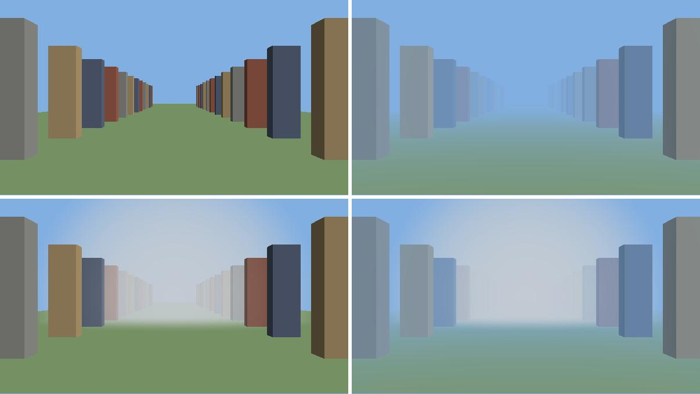
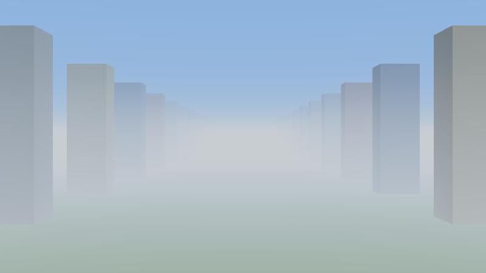
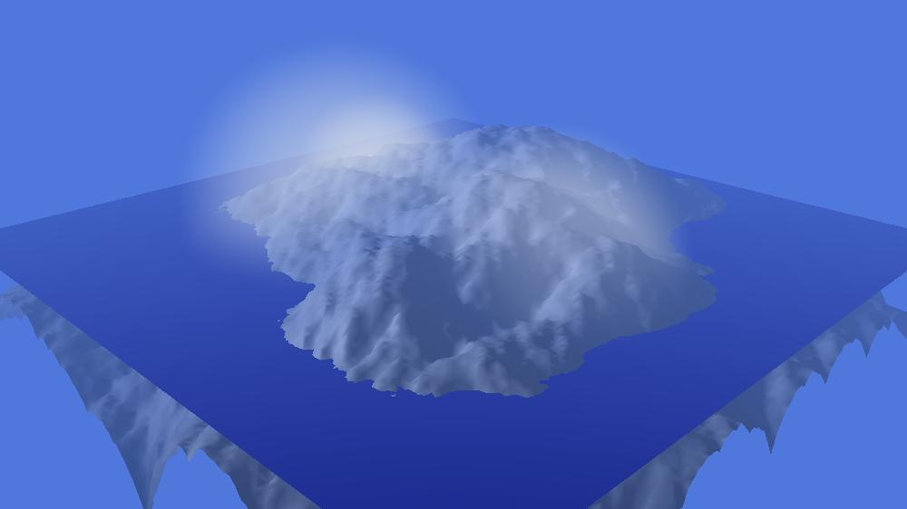

# Aventura — Atmosphere Cookbook

How to put air around a scene: a haze that pales the distance, banks of fog, switches to turn them on and off from the
application, and your own kind of fog.

| | |
|---|---|
| **For** | Programmers who build scenes in code and want the `World` to bathe in an atmosphere, or need a phenomenon Aventura does not provide |
| **Prerequisites** | The [README](../README.md) "Hello, Aventura" example and its [Atmosphere](../README.md#atmosphere) section; [DESIGN.md](DESIGN.md) for the big picture. For the geometry of the `World` itself, see the [Geometry Cookbook](GEOMETRY_COOKBOOK.md) |
| **Examples** | [`src/test/java/com/aventura/cookbook`](../src/test/java/com/aventura/cookbook): [`AtmosphereCookbook`](../src/test/java/com/aventura/cookbook/AtmosphereCookbook.java) (the scene and the recipes) and [`GroundMist`](../src/test/java/com/aventura/cookbook/GroundMist.java) (a new fog) are compiled and tested ([`TestAtmosphereCookbook`](../src/test/java/com/aventura/cookbook/TestAtmosphereCookbook.java)) |

<p align="center">
  
</p>

*The scene of this cookbook ([`AtmosphereCookbook`](../src/test/java/com/aventura/cookbook/AtmosphereCookbook.java)), in four
atmospheres: clear air (top left), the haze of recipe 1 (top right), the bank of fog of recipe 2 (bottom left) and both,
what recipe 3 switches on and off (bottom right).*

---

## Contents

1. [The model in five minutes](#1-the-model-in-five-minutes)
2. [The contracts of an effect](#2-the-contracts-of-an-effect)
3. [The toolbox](#3-the-toolbox)
4. [Recipe 1 — A haze](#4-recipe-1--a-haze)
5. [Recipe 2 — A bank of fog](#5-recipe-2--a-bank-of-fog)
6. [Recipe 3 — Switches, from the application](#6-recipe-3--switches-from-the-application)
7. [Recipe 4 — A fog that moves](#7-recipe-4--a-fog-that-moves)
8. [Recipe 5 — A new kind of fog: the ground mist](#8-recipe-5--a-new-kind-of-fog-the-ground-mist)
9. [Testing your atmosphere](#9-testing-your-atmosphere)
10. [Pitfalls](#10-pitfalls)
11. [What is not there yet](#11-what-is-not-there-yet)

---

## 1. The model in five minutes

The `World` holds geometry (the [Geometry Cookbook](GEOMETRY_COOKBOOK.md)), lights (the `Lighting`) and, now, the
air it bathes in: its `Atmosphere`. The three are organized the same way, one root and several leaves:

```
Lighting                          Atmosphere
├── AmbientLight                  ├── Haze            (at most one)
└── lights (Directional,          └── fogs            (as many as you want)
    Point, Spot...)                   └── SphericalFog, GroundMist (yours)...
```

`Haze` and `Fog` are both an `AtmosphericEffect` (in `com.aventura.model.atmosphere`), which only brings the `enabled`
flag. What each one does to the picture:

| Effect | What it is | What the renderer does |
|---|---|---|
| `Haze` | The air of the whole scene: the farther an object, the paler | Blends each pixel with the haze color by a share that grows with the **distance to the camera** (read in the depth buffer). The sky is not changed. |
| `Fog` | A *volume* in which the air is thick, at a place of the World | Follows the ray of each pixel through the volume, integrates the density, and blends by `exp(-optical depth)`. It dims the sky too. |

The strength of both is a **visibility**: the distance, in scene units, at which the contrast of an object with its
background falls to 5% (for a fog, through its densest part).

The atmosphere is drawn by the renderer **after** the main pass, as a post-process of the finished image, using the
depth buffer: nothing is added to the geometry, and the rendering of the triangles is not changed. Then come the
landmarks, the light vectors and the visible lights (sun, halos), so they keep all their brightness.

Everything is off until you ask for it, and can be switched at four levels (recipe 3):

```
RenderContext.setAtmosphere(boolean)     the whole atmosphere (off by default)
└── Atmosphere.setHaze(boolean)          the haze
└── Atmosphere.setFog(boolean)           all the fogs at once
    └── effect.setEnabled(boolean)       one haze or one fog
```

An effect is drawn when every switch above it is on.

## 2. The contracts of an effect

These rules are what `AtmosphereRenderer` relies on. They hold for any new `Fog`, and are checked by the tests
of the recipes (§9).

### A1 — A new fog extends `Fog`, and gives its optical depth

`Fog` has a color and a visibility (with their setters, which return the fog) and three things left to you:

```java
public abstract Vector4 getBoundingCenter();
public abstract float getBoundingRadius();
public abstract double opticalDepth(double ox, double oy, double oz, double dx, double dy, double dz, double sMax);
```

Nothing else: the color of the pixels, the order of several fogs, the transmittance table and the threads are the
renderer's.

### A2 — The bounding sphere contains the fog

The renderer only looks for the fog on the part of the image where this sphere projects: a fog outside its sphere is
cut off. A fog without limits (a layer, recipe 5) gives a huge sphere, and is looked for on the whole image. The
smaller the sphere, the cheaper the fog: a pixel outside it costs nothing.

### A3 — The optical depth is the integral of the density along the ray

The ray is `O + s·D`, for `s` in `[0, sMax]`: `O` is the eye, `D` the direction of the pixel and **not necessarily a unit
vector** (take its length into account: the optical depth is the one of the real path), `sMax` the parameter where the ray
meets a surface. It is `Double.POSITIVE_INFINITY` for a pixel of the sky. The result is the integral of the extinction
coefficient along that part of the ray, and the pixel gets `color·exp(-τ) + fog color·(1 - exp(-τ))`. the constant
`K_EXTINCTION` (3, available to the subclasses of `Fog`) ties the density to the visibility: `σ0 = 3 / visibility` is the extinction coefficient where the fog is the densest,
since `exp(-3)` is 5%.

### A4 — It is exact, never NaN, and 0 when the ray misses

Compute the integral in closed form when you can, as `SphericalFog` (a cubic) and `GroundMist` (a trapezoid) do: the
image then depends on no sampling and does not flicker when the camera moves. Return `0` when the ray does not meet the
fog, and **never `NaN`**: watch for `0 × ∞` (a ray along a layer, going to the sky, is `∞`; one at the very top of it, where
the density is nil, is `0`). An infinite result is fine: the pixel gets the color of the fog.

### A5 — Coordinates of the World; no state, no allocation

The ray and the bounding sphere are in the coordinates of the `World`: a fog does not belong to the tree of the geometry
and does not follow its transformations. `opticalDepth()` is called for every pixel of the rectangle, **from several threads
at once** (the rows are shared among them): it must not modify the fog nor allocate objects. Parameters that change between
two images (a `setCenter()`, recipe 4) are set between two renderings, never during one.

### Checklist

- [ ] `extends Fog`; the constructor validates its parameters (`IllegalArgumentException`) and passes the visibility to `super`
- [ ] The bounding sphere contains every point where the density is not nil
- [ ] `opticalDepth()` is the exact integral along `O + s·D`, `D` not normalized, `sMax` possibly infinite
- [ ] 0 when the ray misses, never `NaN`, no state, no allocation
- [ ] A test compares it with a numerical integration (§9)

## 3. The toolbox

### The atmosphere (`com.aventura.model.atmosphere`)

| Class / method | Use |
|---|---|
| `new Atmosphere()`, `new Atmosphere(haze)` | The air: with no effect, or with a haze. `world.setAtmosphere(atmosphere)` gives it to the `World` (null: clear air) |
| `addFog(fog)`, `removeFog(fog)`, `clearFogs()`, `getFogs()` | The fogs. The methods that modify return the atmosphere, so they chain |
| `setHaze(haze)`, `getHaze()` | Replace the haze (null for none) |
| `setHaze(boolean)`, `setFog(boolean)`, `isHaze()`, `isFog()` | The switches of the two branches (recipe 3) |
| `isActive()`, `getActiveFogs()`, `getEffects()` | What is drawn, and everything there is |

### The haze

| Setter | Meaning |
|---|---|
| `new Haze(visibility)` | The distance of 5% of contrast (100 by default) |
| `setStartDistance(d)` | The first `d` units are clear |
| `setModel(model)` | `EXPONENTIAL` (default), `EXPONENTIAL_SQUARED` (clear near, then a faster fade) or `LINEAR` (from the start distance to the visibility) |
| `setMaxFactor(f)` | The largest share of haze in a pixel (0.95 by default): leaves a trace of their color to the farthest objects |
| `setColor(color)` | Its own color; null (default) is the background color of the `World`, i.e. the sky |
| `factorAt(distance)` | The share of haze at a distance: handy for a test or a graph |

### The fogs

| Class | Parameters |
|---|---|
| `SphericalFog(center, radius, visibility)` | A sphere whose density is highest at the center and falls to nothing at the surface (`σ0·(1 - r²/R²)`): no visible edge. Through the center `τ = 4R / visibility`; from the center to the outside, `2R / visibility` |
| your own `Fog` | Recipe 5 |

`setCenter()`, `setRadius()`, `setVisibility()` and `setColor()` can be changed between two images. A fog has a light grey
color by default (`Fog.DEFAULT_COLOR`), and a visibility of 10 (`Fog.DEFAULT_VISIBILITY`).

### The RenderContext

`new RenderContext(...).setAtmosphere(true)` draws the atmosphere of the `World`. It is not drawn in `LINE` rendering
(nothing to blend) nor under an orthographic perspective (no distance to the camera).

## 4. Recipe 1 — A haze

The scene is a lawn and two rows of pillars of 1.5 × 1.5 × 5 units, 6 units on each side of the axis, one every 8 units
for about 100 units, seen at the height of a walker's eye. Without atmosphere the last pillars are as dark as the first ones
(top left of the picture above).

```java
Haze haze = new Haze(80f).setStartDistance(5f);   // 5% of the contrast at 80 units, the first 5 units clear

World world = AtmosphereCookbook.createWorld();   // a sky as background color: also the color of the haze
world.setAtmosphere(new Atmosphere(haze));

RenderContext rc = new RenderContext(RenderContext.RENDER_STANDARD_INTERPOLATE).setAtmosphere(true);
```

What the renderer does for each pixel: it reads in the depth buffer the depth `W` of the surface, turns it into the
distance along the ray `W·√(1 + (x/f)² + (y/f)²)` (so that turning the camera on the spot changes nothing), asks the
haze for the share `f(d)`, and blends the pixel with the color of the haze: `color·(1 - f) + haze·f`. The sky is at the far plane and
not touched: since the haze has the color of the sky, the objects *melt into it*.

With the visibility of the example, the third pillar (23 units from the eye) has lost half of its contrast with the sky, the
eleventh (87 units) nearly all of it, which the test checks against `haze.factorAt(distance)`.

| To get | Do |
|---|---|
| A fog-like morning | A smaller visibility (`new Haze(30f)`) |
| Clear air near, then a wall | `setModel(Haze.Model.EXPONENTIAL_SQUARED)` |
| A visible far horizon | `setMaxFactor(0.8f)` |
| A black or indoor background | `setColor(...)`: the default color is the background, which would darken the objects |

## 5. Recipe 2 — A bank of fog

```java
SphericalFog bank = new SphericalFog(new Vector4(0f, 30f, 2.2f, 1f), 12f, 20f);
// center (on the lawn, 38 units ahead of the eye, at the height of the eye), radius 12, visibility 20

Atmosphere atmosphere = new Atmosphere().addFog(bank);
world.setAtmosphere(atmosphere);
```

A ray that crosses the bank through its center meets an optical depth of `4 × 12 / 20 = 2.4`: `exp(-2.4)` = 9% of the light
goes through. The sky behind it (the middle of the image) is blended with the grey of the fog by that share; the pillars
before it (the first ones on each side) are not changed, the ones in it are paler, and the sky at the left and right of the
bank is untouched (bottom left of the picture above).

Two things to know about a bank of fog:

- **It has no edge.** The density falls to nothing at the surface of the sphere, so it fades into the clear air in
  every direction, and the camera can enter it: from inside, every ray sees `2R / visibility` (1.2 here) of optical depth
  whatever its direction, and the fog is seen all around.
- **It hides the sky.** The haze cannot (its share is the same for the sky and the far hills, which are "at infinity"):
  a fog is what you want for a bank of cloud or smoke in front of a sunset.

The fog is drawn after the haze, so the haze veils the bank too. With several fogs, they are drawn from the farthest to the
nearest.

## 6. Recipe 3 — Switches, from the application

A menu of the GUI, a key, a script of the application: all of them go through the same four switches (§1).

```java
Atmosphere atmosphere = AtmosphereCookbook.createAtmosphere();   // haze + bank of fog
world.setAtmosphere(atmosphere);

atmosphere.setFog(false);                // the fogs are out, the haze stays   (top right of the picture)
atmosphere.setFog(true).setHaze(false);  // the haze is out, the fogs stay     (bottom left)
atmosphere.setHaze(true);                // both                                (bottom right)

atmosphere.getFogs().get(0).setEnabled(false);          // one fog, by itself
renderContext.setAtmosphere(false);                      // all of it, without touching the atmosphere
```

`setHaze(boolean)` and `setFog(boolean)` keep the effects themselves (their parameters and their own `enabled`): putting a
switch back on gives the picture as it was. With both out, `atmosphere.isActive()` is false and the renderer does not even
start a pass.

The `FractalLandscape` demo does exactly that: its `Effects` menu has a `Haze` and a `Fog` item, which call
`setHaze(boolean)` and `setFog(boolean)` and render again. The `SceneViewer` too, with the scenes of
`DocumentationImages`.

## 7. Recipe 4 — A fog that moves

A fog is a plain object with a position: move it between two images and render again.

```java
SphericalFog bank = AtmosphereCookbook.createFogBank();
world.setAtmosphere(new Atmosphere().addFog(bank));

for (int i = 0; i <= 100; i++) {
    bank.setCenter(AtmosphereCookbook.driftingCenter(i));   // from x = -14 to x = 14 and back
    view.render();                                           // or whatever draws one frame
}
```

`driftingCenter(i)` is a cosine, so the bank starts and stops softly. Nothing else needs to be told: the bounding sphere
follows the center, the part of the screen where the fog is looked for is recomputed for each image, and the image after
a full lap is **identical** to the first (the test checks it pixel by pixel). The same goes for the radius (a fog that
swells), the visibility (a fog that thickens: `bank.setVisibility(...)`) and the color (a fog at sunset).

As the fog is in the coordinates of the World, it does not follow a moving object. To attach one to a vehicle, move it at
the same time (`setCenter()` with the world position of the vehicle).

## 8. Recipe 5 — A new kind of fog: the ground mist

A bank is a sphere. What about a mist that hugs the ground, thickest on the lawn and gone 4 units higher, as wide as the
World? Nothing in the engine has to change: a `Fog` only gives its optical depth along a ray and its bounding sphere
(§2). The whole class is [`GroundMist`](../src/test/java/com/aventura/cookbook/GroundMist.java).

### Step 1 — Define the density, and the integral

With `σ0 = 3 / visibility` and the density at altitude `z`:

```
σ(z) = σ0 · (1 - (z - baseZ) / height)       for baseZ <= z <= baseZ + height, 0 elsewhere
```

Along a ray the altitude is `z(s) = oz + s·dz`: it is *linear* in `s`, and so is the density. The integral over the part
`[sa, sb]` of the ray that is in the layer is the length of that part times the average of the densities at its two
ends: `τ = σ0 · |D| · (sb - sa) · (σa + σb) / 2`, where `σa` and `σb` are the relative densities at the ends. It is exact:
no marching, no sampling.

### Step 2 — The constructor (A1)

```java
public GroundMist(float baseZ, float height, float visibility) {
    super(visibility);
    if (!(height > 0f)) throw new IllegalArgumentException("The height of the layer must be greater than 0: " + height);
    this.baseZ = baseZ;
    this.height = height;
}
```

### Step 3 — The bounding sphere (A2)

The layer has no limit sideways: a sphere large enough that every image is covered.

```java
private static final float HUGE = 1e6f;

public Vector4 getBoundingCenter() { return new Vector4(0f, 0f, baseZ + height / 2f, 1f); }
public float getBoundingRadius()   { return HUGE; }
```

(A sphere that contains the eye, or that reaches behind it, is looked for on the whole screen; one that is entirely behind the eye is skipped.)

### Step 4 — The optical depth (A3, A4)

```java
public double opticalDepth(double ox, double oy, double oz, double dx, double dy, double dz, double sMax) {
    double length = Math.sqrt(dx * dx + dy * dy + dz * dz);
    if (length <= 0.0) return 0.0;
    double sigma0 = K_EXTINCTION / visibility, top = baseZ + height;

    double sa, sb;                                   // the part of the ray that is in the layer
    if (dz == 0.0) {                                 // horizontal: all or nothing
        if (oz < baseZ || oz > top) return 0.0;
        double density = 1.0 - (oz - baseZ) / height;
        if (density <= 0.0) return 0.0;              // at the very top: nothing (and not 0 x infinity)
        return sigma0 * density * length * sMax;     // infinite for the sky: the pixel gets the color of the mist
    }
    double t0 = (baseZ - oz) / dz, t1 = (top - oz) / dz;
    sa = Math.max(0.0, Math.min(t0, t1));
    sb = Math.min(sMax, Math.max(t0, t1));
    if (sb <= sa) return 0.0;                        // the ray misses the layer, or stops before it

    double densityA = 1.0 - (oz + sa * dz - baseZ) / height;
    double densityB = 1.0 - (oz + sb * dz - baseZ) / height;
    return sigma0 * length * (sb - sa) * (densityA + densityB) / 2.0;
}
```

The two traps of the contract are visible here: the horizontal ray (`dz == 0`, where `t0` and `t1` would be infinite)
is handled apart, and the density is tested before it is multiplied by an infinite `sMax`. A ray that goes up through
the layer to the sky (`sMax = ∞`) is fine: `sb` is the top of the layer, finite.

### Step 5 — Use it

```java
Atmosphere atmosphere = new Atmosphere(new Haze(80f).setStartDistance(5f));
atmosphere.addFog(new GroundMist(0f, 4f, 30f));   // from the lawn up to 4 units, visibility 30 at its foot
```

<p align="center">
  
</p>

*The avenue in the ground mist (`AtmosphereCookbook.createGroundMistAtmosphere()`): the camera is inside the layer, at
the height of the eye (2.2, 55% of the way up). The pillars lose their feet first, the horizon, seen along the layer, is
lost in the mist, and the sky gets back its blue higher in the image, where the rays leave the layer.*

### Step 6 — Test it (§9)

[`TestAtmosphereCookbook`](../src/test/java/com/aventura/cookbook/TestAtmosphereCookbook.java) checks `GroundMist` against
closed-form values (straight down: `σ0·height/2`; horizontal at the foot: `σ0` per unit of length), against a numerical
integration of rays of every kind (up, down, through the layer, to the sky), and in the image.

## 9. Testing your atmosphere

### Optical depth: against a numerical integration

The most useful test of a new `Fog`: a brute-force sum along a set of rays, much finer than the renderer would ever do,
to compare with the closed form:

```java
double tau = 0, ds = sMax / 400000;
for (int i = 0; i < 400000; i++) {
    double z = oz + (i + 0.5) * ds * dz;
    if (z >= baseZ && z <= top) tau += sigma0 * (1 - (z - baseZ) / height) * ds * length;
}
assertEquals(tau, mist.opticalDepth(ox, oy, oz, dx, dy, dz, sMax), 2e-3);
```

Include rays that start inside, above and below the fog, go up, down, horizontally, to the sky (`sMax = ∞`) and not
unit-length: they are the ones that find the sign errors and the `NaN`.

### In the image

Render off-screen at low resolution (`DemoScene.render()`, like `AtmosphereCookbook.createScene(atmosphere, pixelsPerUnit)`)
and check pixels: which point of the scene is at which pixel is an ordinary projection (`TestAtmosphereCookbook.onScreen`),
and the expected colors are simple: the sky seen through a fog of optical depth `τ` is `sky·exp(-τ) + fog·(1 - exp(-τ))`,
and the share of haze at a distance is `haze.factorAt(d)`. Compare switched on and off (`differences(...)` of two images
is 0 when nothing should change), and compare the *same* atmosphere before and after a change you did not mean to be
visible.

### Looking by eye

Add the scene to `DocumentationImages.scenes()` (`ground_mist`, `fog_landscape`, `fog_avenue`...) and open it in the `SceneViewer`:
its Atmosphere, Haze and Fog items switch each branch on and off to compare, and the camera moves with the mouse.
The `FractalLandscape` demo does it on a terrain: `Landscape` menu → *Generate fog* draws new banks of fog at random
places and sizes, and the `Effects` menu switches the haze and the fog (no fog by default).

<p align="center">
  
</p>

## 10. Pitfalls

| Symptom | Likely cause | Fix |
|---|---|---|
| Nothing changes | `RenderContext.setAtmosphere(true)` forgotten, or the atmosphere not given to the `World`, or `LINE` rendering / orthographic perspective | Set both (README) |
| The haze darkens the far objects | The background is black (or not a sky) and the haze takes its color | `haze.setColor(...)` |
| A bank of fog is cut off by a straight line | Its bounding sphere is smaller than the fog (custom `Fog`) | A2: enlarge it |
| A rectangle of the image is a different color | The bounding sphere is much larger than the fog and the density is not nil at its surface (custom `Fog`): the fog is cut by the sphere | Same |
| Black or white pixels in the fog | `opticalDepth()` returns `NaN` (`0 × ∞`, `0 / 0`) or a negative number | A4 |
| The fog does not dim the sky | It is a haze, which only veils what is in the depth buffer | Use a `Fog`: it follows the ray up to infinity |
| The fog stays where it was when its object moves | A fog is in the coordinates of the World, not in the tree | Move it with `setCenter()` (recipe 4) |
| Image flickers or has bands | `opticalDepth()` samples the density (marching) instead of integrating | Closed form, or a very fine step |
| Flipping a switch has no effect | `setFog(false)` on a copy, or an atmosphere that is not the one of the `World` | One `Atmosphere` object, given to the `World` |
| A fog costs a lot | A huge bounding sphere (the whole image) and a costly `opticalDepth()`, called per pixel | Tighten the sphere, avoid allocations and `Math.pow` in `opticalDepth()` |

## 11. What is not there yet

The atmosphere is meant to grow ([DESIGN.md](DESIGN.md)): clouds, rain, a layer of mist that
hugs the ground as a built-in class (recipe 5 is a first version), a fog that is not a sphere (a box, a cylinder)... Each
is a new class, a branch of the `Atmosphere` (like `Haze` and `Fog` under `AtmosphericEffect`), and a pass in
`AtmosphereRenderer`. Known limits of what is there: a fog has a color of its own but is not lit (it does not catch the light of the sun, so
there is no light shaft in a fog), and the atmosphere is a post-process of the finished image, using the depth buffer:
what is drawn after it (landmarks, light vectors, halos of the lights) is not veiled.

---

*Aventura is © 2014–2026 Olivier Barry, released under the [MIT License](../LICENSE.md).*
