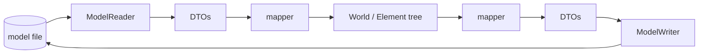
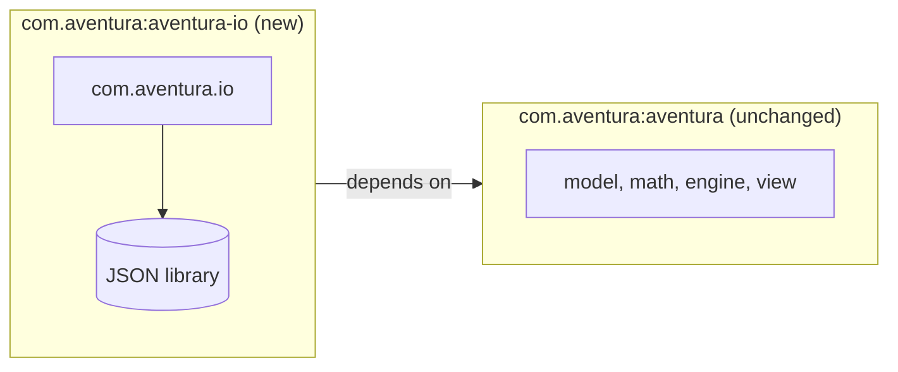

# Aventura — Reading and Writing 3D Model Files

Analysis and implementation plan for saving a scene to a file and loading it back.
Status: **proposal, nothing implemented yet**. Tracked in [BACKLOG.md §9](BACKLOG.md#9-reading-and-writing-3d-model-files).
Written in November 2026 against the code of the `Refactoring` branch (Maven layout, `GenerativeElement`,
atmosphere and visible lights already in place).

## Contents

1. [Goals and non-goals](#1-goals-and-non-goals)
2. [What the model looks like today](#2-what-the-model-looks-like-today)
3. [Scope and phases](#3-scope-and-phases)
4. [The Aventura JSON format](#4-the-aventura-json-format)
5. [Architecture of the I/O module](#5-architecture-of-the-io-module)
6. [Maven structure: a separate build target](#6-maven-structure-a-separate-build-target)
7. [Changes required in the engine](#7-changes-required-in-the-engine)
8. [Step-by-step plan](#8-step-by-step-plan)
9. [Testing strategy](#9-testing-strategy)
10. [Errors and validation](#10-errors-and-validation)
11. [Open questions and decisions](#11-open-questions-and-decisions)

---

## 1. Goals and non-goals

**Goals**

- Save a `World` (a tree of `Element`s with their transformations, colors and textures) to a file, and load
  it back with no loss: the reloaded scene renders exactly like the original.
- Use an Aventura-specific JSON format first, because it can describe the whole element tree and the
  model matrices, which flat formats such as OBJ cannot.
- Keep the **rendering engine free of any third-party library** (see `CLAUDE.md`: "no third-party runtime
  dependency"). The file support, and the JSON library it needs, live in a **separate Maven module** that is
  built and released on its own (see [section 6](#6-maven-structure-a-separate-build-target)).

**Non-goals (for the first iterations)**

- Saving the rendering configuration (`RenderContext`, `PerspectiveContext`): these describe how to draw,
  not what to draw.
- Importing arbitrary third-party scenes (glTF, FBX, ...). OBJ is a possible later addition, see
  [section 3](#3-scope-and-phases).
- Streaming or very large models: the file is read and written as a whole.

---

## 2. What the model looks like today

The following facts were checked in the source before writing this plan, because they drive the design.

| Fact | Consequence for the file format |
|---|---|
| A scene is one `World`: a list of root `Element`s, a background color, a world color, an optional `Atmosphere`. | The natural root of the file. |
| An `Element` has a name (the constructor appends a unique id to it), `isClosed`, an element color, a specular color and exponent, a **local** model matrix (`transform`), sub-elements, vertices and triangles. | All of these are written; the name is restored exactly with `setName()`. |
| `Element.getTransformation()` returns `full`, the **accumulated** world matrix; the local matrix (`transform`) has no getter. | The writer needs the local matrix: it must not write `full`, which would be applied twice by the parents on reload. A getter is required ([section 7](#7-changes-required-in-the-engine)). |
| A `Vertex` has a position, an optional normal and an optional color (the color is currently ignored by the renderer, see BACKLOG §5). Its world and projected positions are derived at render time. | Write position, normal and color; never the derived data. |
| A `Triangle` references three `Vertex` objects (shared with other triangles), and may carry a color, a `Texture`, three texture coordinates (`t1..t3`) and a texture orientation. | Vertices are written once in a list and triangles refer to them by index. |
| `Mesh` classes (`RectangleMesh`, `FanMesh`, ...) only help generating triangles; once built, face colors and textures are stored on the triangles. | Writing raw triangles captures everything the meshes produced. |
| **Materials are not stored in the model.** `SolidMaterial` and `TexturedMaterial` are created by the engine at render time from the element colors and the triangle texture. | No `Material` is serialized. |
| A `Texture` keeps only its decoded texels (`int[]`, width, height), **not the file it came from**, nor the direction and orientation arguments of its constructor. | A file can reference a texture by path only if the engine remembers it ([section 7](#7-changes-required-in-the-engine)). |
| Built-in shapes (`Sphere`, `Box`, `Cylinder`, `Cone`, `ConeFrustum`, `Torus`, `Pyramid`, `Trellis`, `Disc`) keep their constructor parameters in package-private fields. Only `Trellis` has getters. | Describing a shape by "type + parameters" needs new getters; writing the generated geometry does not. |
| `World.build()` generates vertices, triangles and normals recursively; `World.rebuild()` first **clears** each element's triangles, then regenerates them. A plain `Element` has no-op `generateVertices()` / `generateTriangles()`. | A raw-loaded element is a plain `Element`: calling `rebuild()` on it would erase its triangles, and `build()` would only recompute its face normals. Loaded worlds must not be rebuilt (see [section 5](#5-architecture-of-the-io-module)). |
| A `Triangle` has a `triangleNormal` flag (use the face normal instead of the vertex normals) and a face normal that is derived from the vertex positions (`calculateNormal()`); the flag is set by `Element.calculateNormals()`, which smooth shapes such as `Sphere` override. | The flag is stored; the face normal is not (it is recomputed on load when the flag is set). |

---

## 3. Scope and phases

The format is designed in layers, so that each phase is useful on its own.

| Phase | Content | Why this order |
|---|---|---|
| **1. Geometry tree** | `World` colors, `Element` tree, local matrices, element colors and specular data, vertices, normals, triangles, triangle colors, textures. Geometry is written **raw** for every element, including the built-in shapes. | Always correct, whatever the shape; no new getters on the shapes; this is the full round trip. |
| **2. Procedural shapes** | A built-in shape may be written as `type` + constructor parameters instead of raw vertices and triangles; the reader rebuilds it by calling the constructor and `build()`. | Much smaller and hand-editable files, but it needs getters on the shapes and a type registry, so it comes after the raw round trip works. |
| **3. Scene** | Camera, lights (with shadow settings and `LightAppearance`), atmosphere (`Haze`, `SphericalFog`). | Everything that makes a complete scene, kept out of phase 1 to keep the first iteration small. |
| **4. Other formats** | OBJ import/export (+ `.mtl`), registered in the same reader/writer registry. | Flat geometry only, no hierarchy; the already planned idea "Model import OBJ" of [DESIGN.md §11](DESIGN.md#11-history-limitations-and-roadmap). It needs no JSON library, so it could also live in the engine: keeping all formats in the I/O module keeps one home for file support. |

Raw geometry is the safe baseline (phase 1); the parameters of the shapes are an optimization of file size
and readability (phase 2).

---

## 4. The Aventura JSON format

Design rules:

- A top-level **signature** `"format": "AVENTURA3D"` and a **format version** `"version": "1.0"` (a
  `major.minor` string), written first in the file and checked on load. See
  [Versioning policy](#versioning-policy) below.
- **Indices, not object references**: vertices are listed once per element, triangles use indices.
- Textures are listed once at the top of the file and referenced by id.
- A float is written with `Float.toString()` precision, which parses back to the exact same `float`
  (no rounding drift between save and load).
- Optional fields are omitted when they have their default value (the files stay readable).
- Colors are `"#RRGGBB"` or `"#RRGGBBAA"` strings.
- The matrix of an element is its **local** model matrix, 16 numbers, row by row. The decomposition into
  scale, rotation and translation is not stored: it is lossy once rotations have been combined.
- **Texture files are never embedded.** A texture is referenced by a path **relative to the model file**, written
  with `/` separators on every platform (so a model and its textures can move together, and the same file reads
  on Windows, Linux and macOS). The reader resolves it against the folder of the model file, not against the
  working directory.
- The file extension is **`.av3d`**; the content is JSON text, with `"format": "AVENTURA3D"`.

Sketch of a file (phase 1):

```json
{
  "format": "AVENTURA3D",
  "version": "1.0",
  "generator": "Aventura 3D 0.0.1",
  "world": {
    "name": "demo",
    "backgroundColor": "#000000",
    "color": "#FFFFFF",
    "textures": {
      "t0": { "path": "../texture/earth.jpg", "direction": 1, "horizontalOrientation": 1, "verticalOrientation": 1 }
    },
    "elements": [
      {
        "name": "building",
        "closed": true,
        "color": "#B0B0B0",
        "specular": { "color": "#FFFFFF", "exponent": 20.0 },
        "matrix": [1,0,0,0, 0,1,0,0, 0,0,1,5, 0,0,0,1],
        "vertices": [
          { "pos": [0.0, 0.0, 0.0], "normal": [0.0, 0.0, 1.0] },
          { "pos": [1.0, 0.0, 0.0], "normal": [0.0, 0.0, 1.0] },
          { "pos": [0.0, 1.0, 0.0], "normal": [0.0, 0.0, 1.0] }
        ],
        "triangles": [
          { "v": [0, 1, 2], "color": "#FF0000", "faceNormal": true, "rectoVerso": false,
            "texture": { "ref": "t0", "uv": [[0,0],[1,0],[0,1]], "orientation": 0 } }
        ],
        "children": [ { "name": "window", "...": "..." } ]
      }
    ]
  }
}
```

### Versioning policy

The signature tells a reader quickly whether the file is an Aventura 3D model at all (a JSON file of
another application fails at the first check, with a clear message). The version is `major.minor`, starting
at **1.0**:

- **Minor** (`1.0` → `1.1`): a change that only **adds** optional fields (for example the `shape` entry of
  phase 2, or the `camera`, `lights` and `atmosphere` entries of phase 3). A reader of the same major
  version reads the file and ignores the fields it does not know; a reader older than the file's minor
  version may lose that extra information, which it can report as a warning.
- **Major** (`1.x` → `2.0`): a change that alters the meaning of an existing field or removes one. A reader
  refuses a file whose major is higher than its own. It may keep one reader per old major (`V1Reader`, ...)
  and convert to the current in-memory model, so that old files stay readable; the writer always writes the
  current version.
- The `generator` field (name and version of the program that wrote the file) is informational only and is
  never used to decide how to read.
- The writer puts `format` and `version` as the **first two entries** of the object, so that a program can
  recognize the file by looking at its first bytes without parsing it all (and gzip, if added later, wraps the
  same content).
- Every released version of the format is described in this document, with its changes.

### Reading and rewriting older files

- **Reading accepts every older version, by default.** A file of a lower minor or of an older major (as long
  as the reader still has the reader for that major) loads normally. The result is not a bare `World` but a
  `ModelDocument`: the `World` plus the file it came from, the **version of the file**, the `generator`, and a
  list of warnings (for example "fields of a newer minor version were ignored").
- **Writing always writes the current version.** The writer never writes an older format.
- **Rewriting a file that was read in an older version is an upgrade, and it is never silent.** When a
  `ModelDocument` is saved **over its own source file** and the file's version is lower than the current one,
  the choice belongs to the caller through an *upgrade policy* in the save options:

  | Policy | Behavior |
  |---|---|
  | `ASK` (default) | Calls the registered `UpgradeConfirmation` (`confirm(file, fromVersion, toVersion)`). `true` upgrades, `false` refuses. If no confirmation is registered, it behaves as `REFUSE`, so a program that did not plan for this never rewrites a file by surprise. |
  | `UPGRADE` | Rewrites in the current version without asking (scripts, batch conversion). |
  | `REFUSE` | Throws `ModelUpgradeRefusedException` (a `ModelIOException`); the file on disk is untouched. |

  The library has no user interface: the confirmation is a callback, and the application decides how to ask
  (a dialog in a Swing program, a prompt on the command line). The message should say what changes: "This file
  is in format 1.0; saving will convert it to 1.1 and older programs may no longer read it. Convert / Save as
  a copy / Cancel."
- **Saving to a different file is not an upgrade question**: it writes the current version, like any "Save as".
  Choosing "Save as a copy" in the dialog above is that case, and leaves the original file as it was.
- **Optional backup.** `SaveOptions.keepBackup(true)` copies the old file to `name.av3d.bak` before an upgrade
  in place.
- **A file with a newer minor than the reader** (written by a more recent program) also needs the choice,
  for a different reason: the fields this reader does not know would be **lost** by the rewrite. The same
  policy and the same confirmation apply, with a message that says information will be dropped. A file with
  a newer major cannot be read at all, so it cannot be rewritten.
- A new world that was never read from a file (`ModelFiles.save(world, path)`) has no source version and is
  simply written in the current version.

In phase 2 an element may carry `"shape": { "type": "Sphere", "params": { "ray": 1.0, "halfSeg": 16 } }`
instead of `vertices` / `triangles`; in phase 3 the `world` object gains `camera`, `lights` and
`atmosphere` entries.

The triangle winding is preserved as written (the face normal depends on it, see BACKLOG §5 about
`Sphere`), and the stored vertex normals are restored as is rather than recomputed.

---

## 5. Architecture of the I/O module

A new package tree, `com.aventura.io`, in the new module only:

```
com.aventura.io
├── ModelReader / ModelWriter            interfaces: read(InputStream | Path) -> ModelDocument, write(ModelDocument | World, ...)
├── ModelDocument                        result of a read: the World + source file, source version, generator, warnings
├── SaveOptions / UpgradePolicy          ASK | UPGRADE | REFUSE, keepBackup; UpgradeConfirmation callback
├── ModelFormats                         registry by file extension (".av3d" now, ".obj" later)
├── ModelIOException                     checked exception for malformed or unsupported files
└── json
    ├── JsonModelReader / JsonModelWriter
    └── dto                              WorldDto, ElementDto, VertexDto, TriangleDto, TextureDto ...
```

Principles:

- **DTOs decouple the file from the engine.** The JSON library maps the file onto small plain classes
  (`ElementDto`, ...) and a mapper converts them to and from `Element` / `Triangle` / `Vertex`. The engine
  classes carry no annotation and know nothing about JSON, and the file format can evolve without touching
  the engine.
- **The writer** walks the tree recursively. For each element it numbers its vertices in list order
  (`Element.getVertices()`), writes the **local** matrix, then the triangles with the index of each vertex
  (an identity map from `Vertex` to index), then the children.
- **The reader** creates a plain `Element` for each entry (raw geometry needs no shape class), restores the
  name, color, specular data and matrix with the public setters, adds the vertices with `addVertex()`
  (or `createVertex()`), the triangles with `addTriangle()` (setting texture, texture vectors and
  orientation), and attaches children with `addElement()`. This exercises the `setParent()` propagation fix
  of November 2026 and the S → R → T composition order, parent first.
- **No `build()` / `rebuild()` on loaded geometry.** A raw-loaded element is a plain `Element` whose
  generation methods do nothing, so `World.rebuild()` would clear its triangles and leave it empty. The
  reader restores the stored vertex normals itself and, for each triangle whose `faceNormal` flag is set,
  calls `Triangle.setTriangleNormal(true)` and `calculateNormal()`; the loaded `World` is then ready for
  `worldProject()`. Scenes that rebuild their geometry (for example an animated `Trellis`) keep working
  from phase 2 on, when such shapes are reloaded through their constructor.



---

## 6. Maven structure: a separate build target

**Requirement.** The file I/O code is a **separate Maven artifact**, so that it can be built and
released separately, and so that `aventura` (the rendering engine) keeps **no dependency other than the JDK**
(JUnit stays in `test` scope). The JSON library is a dependency of the I/O artifact only.



Two ways to organize the repository:

| Option | Layout | For | Against |
|---|---|---|---|
| **A. Sibling project (chosen)** | Keep the root `pom.xml` as the engine. Add `aventura-io/` at the project root, with its own `pom.xml` and `src/main/java`, `src/test/java`. It depends on `com.aventura:aventura:${project.version}`. | The engine build, the Eclipse configuration (`.project`, `.classpath`) and the "run from the project root" convention do not change. Nothing moves. | Two builds: the engine must be installed first (`mvn install` at the root), then `mvn test` in `aventura-io/`. No single `mvn` command builds both. |
| **B. Multi-module reactor** | A parent `pom.xml` (packaging `pom`) with `<modules>`; the engine moves to `aventura-engine/`, the I/O module is `aventura-io/`. | A single `mvn test` at the root builds and tests both in the right order; the cleanest long-term structure. | Every engine file moves, which breaks the Eclipse project and the relative `./resources/texture` paths, and rewrites a large part of the Git history view. A root `pom.xml` cannot be both a `jar` and an aggregator. |

**Decision: option A, a sibling folder** (`aventura-io/` next to the root `pom.xml`). Moving to **B** stays
possible later if more modules appear (for example several formats or tools). Whatever the option:

- Do not edit `.project`, `.classpath` or `.settings/` (see `CLAUDE.md`); in Eclipse, `aventura-io` can be
  imported as its own Maven project.
- The I/O module declares its dependencies explicitly (the JSON library, the engine, JUnit in `test` scope).
  Its version is aligned with the engine (`0.0.1-SNAPSHOT` for now).
- The engine must not reference `com.aventura.io`: the dependency goes one way only. A test of the engine
  that fails to compile without the I/O module would be a sign of a leak.
- The demos that load a file (for example a `SceneViewer` menu "Open...") would need the I/O artifact, so
  they belong in the I/O module (or in a separate demo module), not in the engine's `demo` package.
- Continuous checks: `mvn test` at the root must keep passing with the I/O module absent.

**JSON library.** Gson (a single jar with no transitive dependencies) is the simplest fit for DTO classes;
Jackson is richer but pulls several jars. Writing a small JSON codec by hand would avoid any dependency
and would make a separate module less necessary, but it is code to write and maintain for a format that is
not Aventura's purpose; the decision is to accept one library, confined to the module.

---

## 7. Changes required in the engine

Small and backward compatible; they are the only engine edits the I/O module needs.

| Change | Where | Why |
|---|---|---|
| A getter for the **local** model matrix (for example `Element.getLocalTransformation()`), and for `hasTransformation` if useful | `Element` | `getTransformation()` returns the accumulated matrix. |
| Remember where a `Texture` came from: the file name and the direction / orientation arguments | `Texture` (new getters, filled by the file constructors) | A saved file refers to a texture by path, which the writer makes relative to the model file. A texture created programmatically (`new Texture(w, h)`) has no source file: saving it is an error (see [section 10](#10-errors-and-validation)). |
| Getters for the constructor parameters of the built-in shapes | `Sphere`, `Box`, `Cylinder`, `Cone`, `ConeFrustum`, `Torus`, `Pyramid`, `Trellis`, `Disc` | Phase 2 only. |
| Optional: a way to set the vertex normals of a loaded element without `calculateNormals()` | existing `Vertex.setNormal()` is enough | Nothing to add if the reader sets them itself. |

No class of the engine gets a dependency on the I/O module or on JSON.

---

## 8. Step-by-step plan

Each step ends with `mvn test` green (engine, and I/O module once it exists).

1. **Baseline.** Run `mvn test` on the engine and check it is green before starting.
2. **Freeze the format** for phase 1: review [section 4](#4-the-aventura-json-format) and the remaining open
   questions of [section 11](#11-open-questions-and-decisions) (compression, normals, demo location).
3. **Engine prerequisites** ([section 7](#7-changes-required-in-the-engine)): the local matrix getter, and the
   texture source information. One small commit each, with unit tests.
4. **Create the module** (option A of [section 6](#6-maven-structure-a-separate-build-target)): `aventura-io/pom.xml`
   (parent-less, depends on the engine and on the JSON library, JUnit 4 in `test` scope), the empty
   `com.aventura.io` packages, a first test that proves the engine artifact is on the classpath. Document the
   two-step build in `README.md`.
5. **DTOs and interfaces**: `ModelReader`, `ModelWriter`, `ModelIOException`, the DTO classes.
6. **Writer for phase 1**: element tree, local matrices, vertices, normals, triangles, colors, textures table.
7. **Reader for phase 1**: the reverse, including the validation of [section 10](#10-errors-and-validation).
8. **Round-trip tests** ([section 9](#9-testing-strategy)).
9. **Facade and demo**: `ModelFiles.load(path)` (returns a `ModelDocument`), `ModelFiles.save(document, path,
   options)` and `ModelFiles.save(world, path)` for a new world, and a small program that loads a saved scene
   and renders it (checked by eye, like the other visual programs). The demo also shows the upgrade
   confirmation of [Versioning policy](#versioning-policy).
10. **Documentation**: update `README.md` (build, usage), [DESIGN.md](DESIGN.md) (package table, the
    "Assets" line of the limitations, the roadmap item "Model import OBJ"), and mark the BACKLOG item.
11. **Phase 2**: shape getters, the `shape` entry, a type registry, tests that a shape written as parameters
    gives the same geometry as the raw round trip.
12. **Phase 3**: camera, lights, atmosphere.
13. **Phase 4** (optional): OBJ reader and writer in the same registry.

---

## 9. Testing strategy

Unit tests only (JUnit 4, headless, as everywhere in the project):

- **Round trip, structural**: build a hierarchy with several levels, non-trivial matrices (scale, rotation,
  translation combined), colors and a textured triangle; write, read, and compare names, tree shape,
  local matrices, vertex and triangle counts, colors and texture references.
- **Round trip, geometric**: after `worldProject()` on the original and on the reloaded world, the **world
  positions and world normals of every vertex are equal**. This also checks the S → R → T order and the
  parent-first composition.
- **Every built-in shape**: write and reload a `Sphere`, `Box`, `Cylinder`, `Cone`, `ConeFrustum`, `Torus`,
  `Pyramid`, `Trellis`, `Disc`, and compare.
- **Render comparison**: render the original and the reloaded scene off-screen with `ImageView` and compare
  the pixels, as the rendering-type tests already do.
- **Stability**: write the reloaded world again and check the two files are identical (a stable output is
  also what makes the files diff well in Git).
- **Errors**: one test per case of [section 10](#10-errors-and-validation).
- **Reading and rewriting older versions**: a file of an older version loads (the document reports its version);
  saving it over itself with each policy: `REFUSE` throws and leaves the file byte for byte unchanged, `ASK` with
  a confirmation that answers `false` refuses, `ASK` with no confirmation registered refuses, `ASK` answering
  `true` and `UPGRADE` rewrite in the current version, `keepBackup` leaves the `.bak` copy; saving to another
  path never asks; a file with a newer minor asks before dropping the unknown fields.
- **Signature and version**: a file without the signature, with another one, or with a malformed version is
  refused; a file with a higher major is refused with the supported versions in the message; a file of the same
  major with a higher minor and unknown extra fields is read; the writer's first two entries are `format` and
  `version`.
- **Relative texture paths**: save a model in a temporary folder next to a copy of a small texture, check the
  stored path is relative with `/` separators, then load it with a different working directory and check the
  texture is found; move the whole folder and load again.
- Texture files are read from `./resources/texture`; tests that need a texture run from the project root
  like the others, and the I/O module tests use a tiny generated image rather than the large ones.

---

## 10. Errors and validation

The reader throws `ModelIOException` (with the position in the file when the JSON library gives it) for:

- malformed JSON, or a missing required field (`format`, `version`, `vertices` of an element...);
- a missing or different `format` signature (the file is not an Aventura 3D model), a `version` that is not
  of the form `major.minor`, or a `major` newer than the reader supports (the message names the file's
  version and the versions the reader supports); see [Versioning policy](#versioning-policy);
- a triangle index outside the vertex list, a matrix that does not have 16 numbers, a vertex without three
  coordinates;
- a reference to an unknown texture id, or a texture file that cannot be loaded from the path resolved against
  the model file (wrapping the engine's `TextureLoadException`; the message names the model file, the relative
  path and the resolved path);
- an unknown shape `type` (phase 2).

The **writer** throws `ModelUpgradeRefusedException` when the upgrade of an older (or newer-minor) file over
itself is refused, and `ModelIOException` for a texture that has no source file (created programmatically),
and for a texture whose path cannot be made relative to the model file (for example another drive on Windows);
nothing is written silently with a path that would not read back.

Unknown **extra** fields are ignored, so that a newer writer's optional additions do not break an older
reader. A cycle cannot occur since the tree is written as nested objects.

---

## 11. Open questions and decisions

**Decided**

- Textures are **not embedded**: they are referenced by a path **relative to the model file**, written with `/`.
  A texture without a source file cannot be saved.
- Every file carries the signature **`AVENTURA3D`** and a format version **`major.minor`**, starting at `1.0`
  ([versioning policy](#versioning-policy)).
- Older files are **read by default**; **rewriting** one over itself in the current version needs an explicit
  choice from the application (policy `ASK` by default, which refuses when nobody can be asked), never a
  silent conversion.
- The file extension is **`.av3d`** (JSON text inside). An editor needs to be told it is JSON (file
  association) to colorize it; the content, not the extension, tells the reader what to parse.
- The I/O module is a **sibling folder** `aventura-io/` ([section 6](#6-maven-structure-a-separate-build-target)).
- "**Aventura 3D**" is the name of the product (documentation, window titles). The code keeps the name
  Aventura: the Maven coordinates (`com.aventura:aventura`, `com.aventura:aventura-io`) and the packages
  (`com.aventura`, `com.aventura.io`) do not change.

**Still open**

- **Compression.** Large landscapes (`Trellis`) make big files; optional gzip on write, detected on read
  (for example `.av3d.gz`).
- **Normals.** Always store them (exact round trip, larger file), or recompute on load when absent? The
  plan stores them, and the reader accepts files without them by calling `calculateNormals()`.
- **Ids.** `Element` ids are assigned by a static counter and are not stable between runs; they are not
  written, and the names (with the id suffix the constructor adds) are written as plain text.
- **Where the demos that open a file live** (I/O module or a separate demo module).
