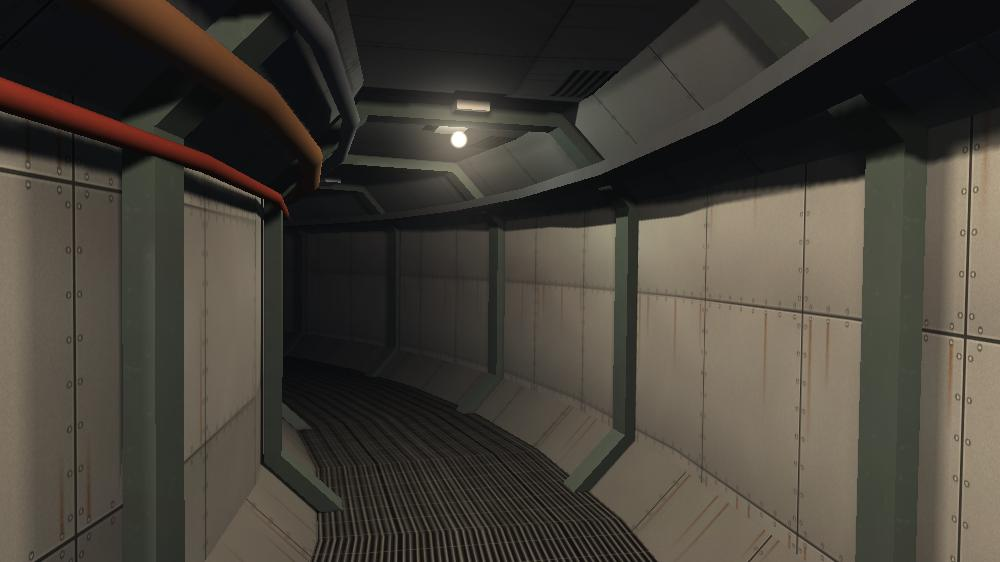
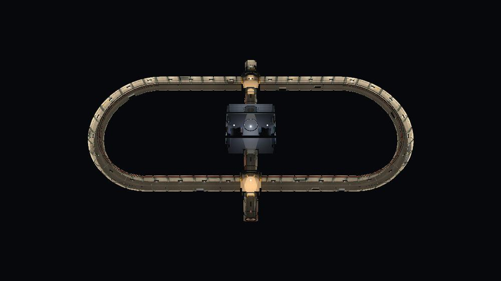
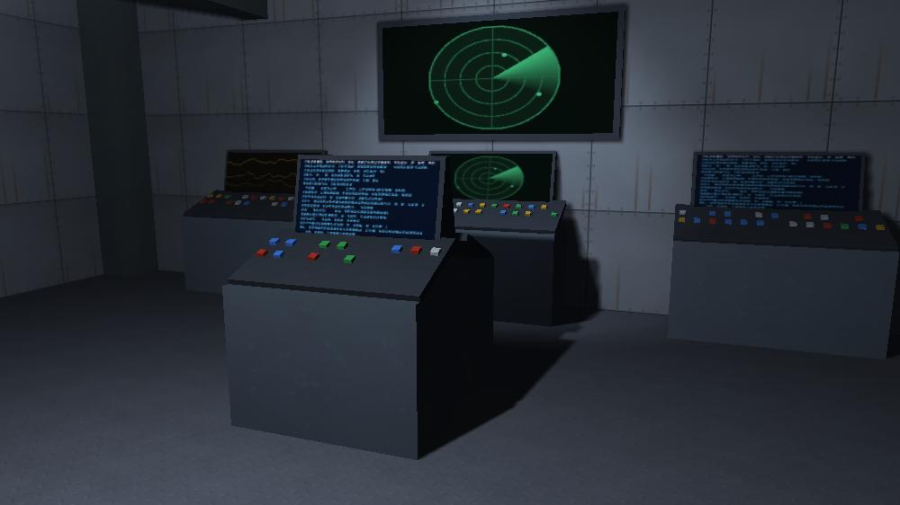
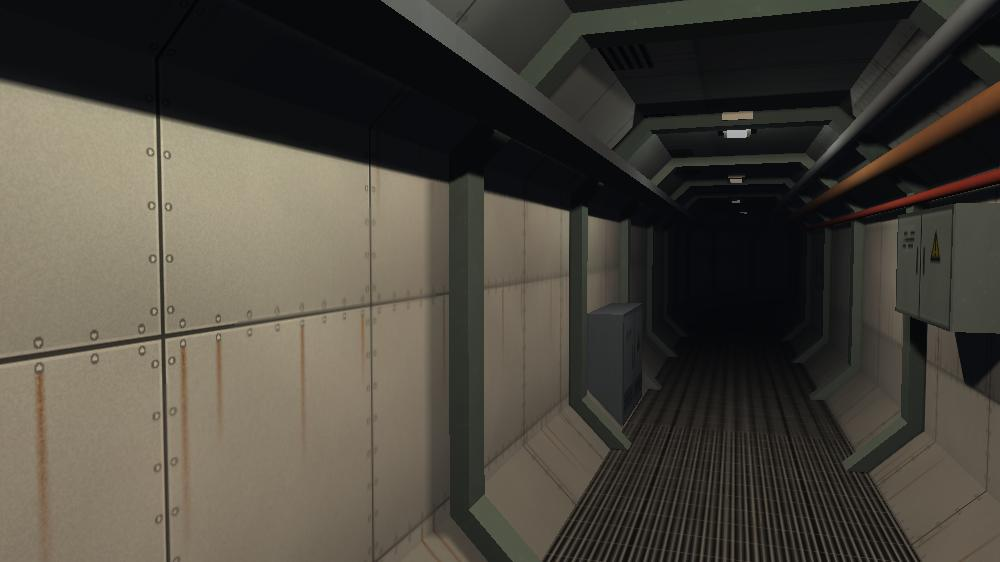

# StarshipInterior — The Making of a Demo

> How the `StarshipInterior` demo was built: its plan, its architecture, its graphic design, the tricks and the design
> choices behind it, its user interface, what could be added, its limitations and its performance. It is the second
> "making of", after [TempleRuins](TEMPLE_RUINS.md): this one is about what that demo does not show — a scene lit by
> its own lights only, many of them, few switched on.
> For the engine itself, see the [Design Overview](DESIGN.md).

<p align="center">
  <br/>
  <em>The east bend, during the visit: a corridor swept along an arc, its ribs, pipes and cable tray following it.</em>
</p>

| | |
|---|---|
| **What** | The inside of a spaceship, in the style of the science fiction films of the late seventies and eighties: futuristic but worn. A loop of metal corridors, straight and curved, a shortcut through a control room, two junctions, airlock doors open and closed, a hatch to the hold, pipes everywhere |
| **Where** | `com.aventura.demo.ship` (16 classes), tests in the same package of the test sources, in the `aventura-demos` module; `LightBudget` in `com.aventura.demo`, shared by the demos |
| **Run** | `mvn test-compile exec:java -Dexec.mainClass=com.aventura.demo.ship.StarshipInterior` (from the project root, or the class `StarshipInterior` run from the IDE) |
| **Scene** | 550 `Element`s, about 15,500 triangles and 15,000 vertices, 10 textures (9 computed, 1 photograph, 3.8 MB), 42 lights (36 point lights, 6 spot lights) and a faint ambient light, a haze |
| **Cameras** | Walk, a guided visit of 201 m walked in 87 s, and a plan view of the whole ship from above |
| **Lights on** | 3 at a time, the nearest to the camera, those in front first, faded in and out (all of them in the plan view) |
| **Engine changes** | `Light.setEnabled()`: a light switched off stays in its `Lighting` but costs nothing (no shading, no shadow map, no halo); its shadow map is kept |
| **Shared by the demos** | `LightBudget` (new), `Noise` and `FlightPath` (moved from `temple` to `com.aventura.demo`) |

## Contents

1. [Goals](#1-goals)
2. [How it was created](#2-how-it-was-created)
3. [The plan](#3-the-plan)
4. [Architecture](#4-architecture)
5. [Graphic design](#5-graphic-design)
6. [Subtleties, tricks and design choices](#6-subtleties-tricks-and-design-choices)
7. [User interface](#7-user-interface)
8. [Tests and documentation images](#8-tests-and-documentation-images)
9. [Features that could be added](#9-features-that-could-be-added)
10. [Limitations](#10-limitations)
11. [Performance](#11-performance)

---

## 1. Goals

The same four goals as TempleRuins, in the same order: look good, teach, use the API as it is, stay interactive. And
one more, the reason for a second demo: **show the parts of the engine that TempleRuins leaves out.** TempleRuins is lit
by a sun; here there is no sun, no sky, no horizon. Everything that is seen is lit by point lights and spot lights, each
one casting shadows.

What the demo shows of the API, beyond what TempleRuins already shows:

| API feature | Where in the demo |
|---|---|
| `PointLight`: light all around, linear fall-off, shadows in a cube of six maps | `ShipLights`: the ceiling lights of the corridors, the light of the control room |
| `SpotLight`: a cone with a soft edge, aimed | `ShipLights`: the junctions (pointing down), the consoles, the hatch |
| Visible point and spot lights (halo, `LightAppearance`) | `ShipLights.add()`, Lights menu |
| `Light.setEnabled()`: many lights, few switched on | `LightBudget`, `StarshipInterior.updateLights()` |
| Static shadow casters, and a caster that moves (`invalidateShadowMap()`) | `ShipLights`, `StarshipInterior.stepDoor()` |
| One new shape, swept along straight or curved paths | `SweptSection` along a `PathSegment`: the walls, the floors, the pipes, the cable trays, the ring of light |
| New shapes with faces seen from one side, given their position directly | `ShipShape`, `SectionFrame` (ribs, door frames), `Panel` (walls with a doorway) |
| Back-face culling: the inside of a closed Element | The plan view sees through the ceilings |
| Textures computed for their size, repeated in meters | `ShipTextures`: plates, grating, tread plate, stripes, screens |
| A texture stretched once over a face | The screens (`Panel` with a tile of 0), the door leaves (`Box`) |
| Colors per triangle over a texture | The kick plates and chamfers of the walls (`SweptSection.setEdgeColors()`), the hazard band of the frames (`SectionFrame.setBand()`) |
| Translations that change between images | The leaves of the north door (`AirlockDoor.setOpening()`) |
| An assembly placed by a Rotation and a Translation | `Console.place()`, the fixtures, the hatch |
| A haze of a dark color, inside | `StarshipInterior.createWorld()` |
| `Camera.updateCamera()` with a rolled up vector | `ShipTour.up()` (the visit banks in the turns) |

---

## 2. How it was created

Like TempleRuins, the demo was written with Claude, from a brief by Olivier:

> The inside of a spaceship, as in a science fiction film, to show point lights, spot lights and different textures.
> A simple network of metal corridors, with spaceship doors (futuristic, but with the worn look of those films), pipes,
> a few control consoles, a larger room, airlock doors closed and others open. A visit like the helicopter tour of
> TempleRuins, with FPV camera turns. A loop of corridors with a shortcut in the middle and a control room. Some
> corridors straight, others curved. At any moment no more than 2 or 3 lights switched on, even if the ship has many
> more. No outside view.

The last constraint shaped everything. The engine computes, for each pixel, the contribution of every light of the
`Lighting`, and draws the shadow map of each one: forty lights would be forty times the work. The first step was
therefore a change of the engine, made on the `features` branch before the demo: **`Light.setEnabled(boolean)`**. A
light switched off stays in its `Lighting` but is skipped by the shading, the shadow pass and the halos. Its shadow map is
not freed: with static casters, a light switched on again reuses it. The demo then only has to choose which lights to
switch on before each image: `LightBudget`.

The second engine change asked for, **emission maps** (a texture that glows by itself, for the screens and the dials),
was put in the [backlog](BACKLOG.md) for later (see [§10](#of-the-engine-as-met-by-the-demo)).

The demo was then built in this order, each step checked on images rendered without a window:

1. `PathSegment` and `SweptSection`, then a single straight corridor and a single bend: the shape, the side of the
   triangles, the textures.
2. `SectionFrame` and `Panel`, the junctions, the doors, the consoles, the control room, the hatch: the whole `Ship`.
3. `ShipLights` and the `LightBudget`, tuned on fixed views (§6, [The light budget](#the-light-budget)).
4. The application, `StarshipInterior`, on the model of TempleRuins, and the visit (`ShipTour`).
5. A strip of 25 images along the visit, to check it all the way; then the tuning of the light and of the speed.
6. The tests, the documentation images, this document.

---

## 3. The plan

```
                         (store)                     behind the closed door of N
        .-------------------[N]-------------------.        y = +12  north corridor
       /                     |                     \
      |                  +---+---+                  |
      |  west bend       |control|       east bend  |      the shortcut crosses the
      |  (R = 12)        | room  |       (R = 12)   |      control room, from the
      |                  +---+---+                  |      south junction to the
       \                     |                     /       north one
        '-------------------[S]-------------------'        y = -12  south corridor
                             |
                           (hatch)                         y = -19  airlock to the hold
       x = -20               x = 0              x = +20
```

The whole plan is in a few constants of `Ship` (`LOOP_HALF_LENGTH`, `LOOP_HALF_WIDTH`, the sizes of `Hub` and
`ControlRoom`): the corridors are `PathSegment`s between them. The same segments carry the walls, the pipes, the
lights, and the path of the visit is made of the same kind of segments (§6, [The visit](#the-visit)).

<p align="center">
  <br/>
  <em>The plan view: the whole ship from above, through its ceilings, all its lights switched on.</em>
</p>

| Part | Size | |
|---|---|---|
| Corridor | 2.6 m wide, 2.7 m high, an octagon (chamfers of 0.35 m at the bottom, 0.6 m at the top) | `ShipSections.corridor()` |
| Door of an airlock | 1.5 m wide, 2.15 m high, the same octagon, smaller | `ShipSections.door()` |
| Junction | 4 x 4 m, 3.2 m high | `Hub` |
| Control room | 10 x 10 m, 3.4 m high | `ControlRoom` |
| Bends | radius 12 m, half circles | `Ship` |
| Loop | 40 m long, 24 m wide, 201 m of visit with the shortcut walked twice | `ShipTour` |

---

## 4. Architecture

### Classes

| Class | Role |
|---|---|
| `StarshipInterior` | The application: the steps of an Aventura program (one method each), the window, the menus, the cameras, the visit, the door |
| `Ship` | The plan and the tree of Elements; where a visitor can walk (`keepInside()`) |
| `PathSegment` | A straight line or an arc of circle in the plan, described by the distance along it |
| `ShipSections` | The cross-sections: corridor, door, pipe, cable tray |
| `SweptSection` | **New shape**: a section swept along a PathSegment |
| `ShipShape` | Base of the flat-faced shapes: adds a quadrilateral turned towards the side it is seen from |
| `SectionFrame` | **New shape**: a ring across a corridor, between two outlines (ribs, door frames) |
| `Panel` | **New shape**: a rectangle, optionally with an octagonal doorway (walls, floors, ceilings, screens) |
| `Corridor` | A corridor: floor, walls, ribs, pipes, cable tray, fixtures; where its lights hang |
| `Hub` | A junction: a doorway, a door or a wall on each side |
| `AirlockDoor` | A frame with hazard stripes and two leaves that slide |
| `ControlRoom` | The room: walls with doorways, consoles, wall screens, beams, ring of light |
| `Console` | A console: cabinet, desk, buttons, screen |
| `ShipTextures` | The textures, computed or read from a file |
| `ShipLights` | The lights and their budget |
| `ShipTour` | The path of the visit, and where the camera looks |
| `LightBudget` (in `com.aventura.demo`) | Switches on the few lights nearest to the camera |

### The steps

`StarshipInterior.createScene()` follows the steps of TempleRuins:

1. `createWorld()`: the World, its dark background and its haze, the `Ship`.
2. `new ShipLights(ship)`: the Lighting and the budget.
3. The Camera, and the visit (`ShipTour`).
4. `createPerspectiveContext()`, `createRenderContext()`.
5. The `RenderEngine`.

Then, before each image, `render()` lets the budget switch the lights (`updateLights()`), and renders.

### The scene tree

```
World "starship interior"
 └── ship
      ├── corridors                 Corridor x 8: the loop (6) and the shortcut (2)
      │    └── Corridor
      │         ├── floor           SweptSection (1 edge: the grating)
      │         ├── walls           SweptSection (7 edges: plates, seen from inside)
      │         ├── ribs            SectionFrame every 2.5 m
      │         ├── pipes           SweptSection x 3 (circles, seen from outside)
      │         ├── cable tray      SweptSection (an open U)
      │         └── light fixtures  Box every 5 m
      ├── airlock corridor          Corridor, to the hatch
      ├── hatch                     end wall (Panel), Disc, Torus x 2, Cylinders
      ├── store, store end          Corridor behind the north door, end wall, crates
      ├── junctions                 Hub x 2: floor, ceiling, walls (Panel), frames, AirlockDoor, pillars
      └── control room              ControlRoom: Panels, AirlockDoor x 2, Console x 10, wall screens, beams, ring
```

---

## 5. Graphic design

### The look of the films

Three ideas, taken from the corridors of the science fiction films of the time:

- **A shape that says "ship"**: the octagonal section, the ribs every 2.5 m, the heavy frames of the doors. In a straight
  corridor the ribs line up into the distance; in a bend they fan out.
- **Worn**: plates of a light warm gray with dark seams, rivets, rust running down from some of them, grime at the bottom
  of each plate; paint chipped on the frames; hazard stripes faded.
- **Lit by its own fixtures**: pools of warm light under the ceiling lights, darkness between them and at the end of the
  corridors, cold light in the control room, amber in the junctions, red at the hatch.

### Palette

| Part | Color | |
|---|---|---|
| Walls | warm light gray (196, 192, 182) | the plates of the hull |
| Kick plates, chamfers | darker grays | colors per triangle, over the same texture |
| Ribs, pillars, beams | dark gray green (92, 104, 96) | painted metal |
| Pipes | copper, steel, red | |
| Frames | dark gray, yellow and black stripes on the edge of the doorway | |
| Corridor lights | warm white (255, 232, 198) | |
| Junction lights | amber (255, 176, 92) | spot lights pointing down |
| Control room | cold white (210, 226, 255), consoles in blue gray | |
| Hatch | red light (255, 70, 50), yellow rim, red wheel | |
| Background, haze | nearly black, a little blue (6, 8, 12) | |

<p align="center">
  
  <br/>
  <em>The consoles of the control room, and the hatch of the hold glanced at from the south junction during the visit.</em>
</p>

---

## 6. Subtleties, tricks and design choices

### One shape for the corridors, the pipes and the trays

`SweptSection` takes a cross-section, a list of (lateral, height) points, and a `PathSegment`. Each point of the
section, at each step along the path, becomes a vertex at `point(s) + lateral * left(s) + height * Z`. That is all a
corridor needs, straight or curved: an octagon swept along a line or along an arc. A pipe is a small circle, offset to
the upper corner of the same octagon and swept along **the same path**: it follows the bend of the corridor without any
further work. A cable tray is an open U. The ring of light of the control room is a circle swept along a full circle — a
torus.

Three choices make it work:

- **Which side is seen** (`Facing`): the walls are seen from inside, the pipes from outside. The class compares the
  normal that the order of the vertices gives with the normal wanted, and turns the triangles over when they differ. The
  sign of the area of the section (counter-clockwise or not) decides; an open profile says by the order of its points.
- **Sharp or smooth** (`Shading`): a corridor has sharp edges between its floor, chamfers, walls and ceiling: each edge
  of the section has its own vertices, with its own normal. A pipe is smooth: a vertex is shared by its two edges and
  takes the average of their normals. In both cases the normals turn with the path: a bend is smooth along its length.
- **Steps**: a straight path needs no step for its shape, but gets one every 4 m (smaller triangles are clipped better by
  the near plane); an arc gets one every 7.5 degrees.

### Textures in meters, even in a bend

The textures are repeated like tiles of a given size in meters: the u coordinate is the distance along the path divided
by the size of a tile, v the distance along the section. In a bend, the outer wall is longer than the inner one: the
distance is measured on each edge of the section, `(1 - lateral x curvature)` times the length of the path
(`PathSegment.curvature()`), so that a plate of the outer wall is as wide as a plate of the inner one.

The computed textures are drawn for the size they cover (a 512-pixel plate texture covers 2 m: a pixel is 4 mm, a seam
1.5 pixels), and drawn to repeat without a seam (`REPEAT`). Their noises are read on circles (`periodicNoise()`), so that
the left edge of the texture continues its right edge. The photographs of TempleRuins are mirrored instead, which would
turn the diagonal ridges of a tread plate into chevrons — a first version of the floors of the junctions had exactly
that, so the tread plate is computed too.

### Ribs that do not trip the visitor

A rib is a `SectionFrame` between the outline of the corridor and the same outline moved inwards by 10 cm
(`SectionFrame.inset()`: each edge moved parallel to itself, the new points where neighbor edges meet again). Moved
inwards, the floor edge would rise by 10 cm: a step every 2.5 m. `ShipSections.insetAboveFloor()` slides the two points
of the floor back down along their chamfer, and the ring is open (`setOpen()`): no rib across the floor.

### Two surfaces in the same plane

The screens are Panels with the texture of a screen, in front of a case or a frame (a `Box`). In the first version the
large screens of the control room were exactly in the plane of the front of their frame: the two surfaces had the same
depth at each pixel, and the Z-buffer kept one or the other depending on the rounding — lines of the frame across the
screen (z-fighting). The small screens, 1 mm in front of their case, were spared at short range only. All the screens now
stand 1 cm in front: well within the precision of the Z-buffer at the distances of the ship.

The same happened to the frames of the passages of the junctions: half of a frame stands in the corridor, and its inner
band followed the outline of the corridor exactly, in the plane of its walls — speckles across the stripes, on the
corridor side only. The band now stands 3 cm inside the walls (`Hub.FRAME_INSET`). The other frames were spared: the
ribs end in the thickness of the walls, and the band of an airlock door follows the smaller outline of the door.

### Doors

A door is a frame from the outline of the corridor to the smaller outline of the door, and two leaves (`Box`es) inside
the thickness of the frame. Open, the leaves slide sideways behind the frame and into the walls, where the depth test
hides them: an open door shows nothing but its frame. The leaves are moved by their `Translation`, which
`AirlockDoor.setOpening()` sets; the World is transformed again at each image. The north door of the north junction
opens and closes on demand (key `D`), on a store room built behind it for that purpose — the first version opened on
the void.

### Back-face culling, and the plan view

All the shapes of the ship are closed Elements: the engine skips the faces turned away from the camera. The walls,
floors and ceilings are seen from inside only, so from above, the ceilings are skipped and the walls are invisible from
outside: the plan view looks into the whole ship like into a doll's house, without any special code.

### The light budget

`LightBudget` is a small class shared by the demos. Before each image, it ranks the lights by their distance to the
camera, switches on the `maxLights` first ones and switches off the others. Three details make the difference between
a correct budget and a good one:

- **No light pops in or out.** A light in the budget gets the intensity
  `full x min(1, (d(first light left out) - d(this light)) / fadeDistance)`. When the camera moves and two lights are
  about to swap their places, both are faded to almost nothing; the change is continuous.
- **The lights in front first.** The distance is made longer for the lights behind the camera:
  `d x (1 + penalty x (1 - cos a) / 2)`. Without it, a light 4 m behind the visitor took the place of the light 5 m ahead,
  and the corridor ahead was dark.
- **No weights.** A first version gave the lights of the control room a weight, to keep them on against the corridor
  light seen through its door. It also gave them a place in the budget from the corridors around the room, through the
  walls: the light ahead in the corridor went out. The preference for the lights in front solved both cases.

The distance is the straight distance: it ignores the walls. A light behind a wall can take a place; the walls cast
shadows, so it does not light through them, but the place is lost. A distance along the corridors, or a visibility
between zones, would be better, and specific to the plan (§9).

### Shadow maps drawn once

Every light keeps its shadow map from one image to the next (`setStaticShadowCasters(true)`): the ship does not move. A
map is drawn the first time its light is switched on, then kept while the light is off. Over a lap of the visit, the
shadow pass costs 1 to 3 ms, against 40 to 60 ms per new cube map. The door is the exception: while it moves, the lights
within their range of it are told to draw their map again (`StarshipInterior.invalidateShadowsNear()`): the others keep
theirs.

### The haze

The haze of TempleRuins pales the distance towards the color of the sky. Here its color is the near black of the
background, and its visibility 45 m: the end of a long corridor, which no light switched on reaches, sinks into the
dark instead of ending on a flat black. In the plan view, 70 m away, it would hide the whole ship: it is switched off
there.

### The visit

`ShipTour` builds the path of the visit from the plan: lines along the middle of the corridors, arcs of 1.5 m in the
junctions, each segment starting where the previous one ends, in the same direction (a test checks it). A closed visit
of the loop and of the shortcut must walk one of their parts twice (the two junctions each have three corridors): the
shortcut, through the control room, is walked twice, southwards both times.

- The eye moves at 2.3 m/s, by the time elapsed since the previous image (as in TempleRuins).
- It looks at the point of the path 3.5 m ahead: in a turn, the head turns before the body.
- At four places the look leaves the path for a point of interest (`Glance`): the consoles of the control room, east
  then west, the hatch from the south junction, the closed door from the north one. The directions are blended, not
  the points, with a weight that rises and falls smoothly over 2 m.
- The camera banks slightly in the turns, like an FPV drone: up to 5 degrees in the junctions, less than one in the
  large bends.

### Walking

The walk keeps the visitor in the corridors and the rooms (`Ship.keepInside()`): within 0.8 m of the middle of a
corridor (and 1 m beyond its ends, through the doorways), 0.6 m from the walls of the rooms, 0.5 m from the middle of a
doorway. A point outside goes to the nearest point inside. The store behind the north door is out of bounds while the
door is closed.

---

## 7. User interface

### Cameras

| Camera | Key | Mouse | Wheel, Up / Down | |
|---|---|---|---|---|
| Walk | `W` | look around | walk forward / backward, horizontally | Left / Right turn |
| Visit | `V` | takes the controls (walk) | takes the controls | `Space`: pause |
| Plan view | `P` | turn around the ship | zoom | all the lights on |

`R` puts the current camera back at its start.

### Field of view

The horizontal field of view is 72 degrees by default, wider than the 53 degrees of TempleRuins: a first person view
needs to see the walls on both sides of a corridor. The Camera menu offers presets (50, 60, 72, 85 and 100 degrees),
and the `+` and `-` keys (typed, or on the numeric keypad) change it by 2 degrees, from 30 to 120.

With a frustum, the field of view is set by the width of the view plane and its distance to the eye:
`tan(fieldOfView / 2) = (width / 2) / distance`. The width is the number of pixels divided by the pixels per unit
(`ResizeMode.KEEP_SCALE`), so the demo changes the distance instead (`Perspective.setDist()`): the nearer the plane, the
wider the view (`StarshipInterior.setFieldOfView()`). The view plane is also the near plane: between 30 and 120 degrees
it stays between 9 cm and 1.5 cm from the eye, near enough for the doorways. Before each image the distance is
computed again for the width of the window, so that resizing the window keeps the field of view.

### Menus

- **Camera**: the camera, pause of the visit, reset, the field of view (presets, `+` / `-`), Statistics (`I`): the size of the scene and the work of the engine
  (the `StatisticsWindow` shared by the demos), with the lights switched on for the last image, ranked, and the rendering
  times of the last lap of the visit.
- **Lights**: the size of the budget (1, 2, 3, 4 or 6 lights), or all the lights on (42): the cost of the lights can be
  measured on the same lap of the visit. The halo of the lights. The north door (`D`).
- **Rendering**: the rendering type.
- **Effects**: textures, mipmapping, specular highlights, shadows, soft shadows, haze.

The title of the window shows the camera and its field of view, the time of the last image, the number of lights switched on and, during the
visit, the average time of the last lap.

---

## 8. Tests and documentation images

| Test | What it checks |
|---|---|
| `TestShipGeometry` | Lines and arcs (points, directions, curvature, nearest point, lateral offset); the outlines turn counter-clockwise, the inset and the ribs above the floor; the walls of every corridor are seen from inside, the pipes from outside, the floors from above and the ceilings from below; where a visitor can walk; the visit is closed, without corners, and stays inside |
| `TestStarshipInterior` | The scene; 3 lights switched on during the visit, all of them in the plan view; images rendered without a window; the north door opens and the lights near it draw their shadow map again; the field of view of the images rendered |
| `TestLightBudget` (in `com.aventura.demo`) | The nearest lights on, the others off; the fading; the lights in front first; all the lights on; the size of the budget |
| `TestLightEnabled` (in the engine) | A light switched off: the same image as without it, no shadow map, no halo, the map kept when it is switched on again |

`DocumentationImages` renders the images of this document (`starship_*.jpg`) as the demo does, the light budget
included: they are not `DemoScene`s, whose lights do not depend on the camera.

---

## 9. Features that could be added

| Feature | How | Effort |
|---|---|---|
| Doors that open as the visitor comes | The distance of the camera to each door, an animation, the shadows invalidated as for the north door | Small |
| Signs on the walls (deck, directions) | A texture drawn with Java2D (`drawString()` into a `BufferedImage`), copied into a `Texture` | Small |
| A budget by zones | The lights of the corridor or the room where the camera is, and of the next ones through the open doors: no light behind a wall | Medium |
| Steam from a pipe | A `SphericalFog` of a light gray near a pipe, perhaps moving | Small |
| Blinking lights, an alarm | The intensity of a light changed at each image (a red spot light turning, on a beacon) | Small |
| A window on the stars | A Panel with a computed star field, once the engine has emissive surfaces | Small, after the engine |
| More rooms | Quarters, an engine room: Panels, Consoles, and new assemblies | Medium |
| A shared camera controller | The walk, the orbit and the visit are again written in the demo (see TempleRuins §8) | Medium |

---

## 10. Limitations

### Of the demo

- **The light budget ignores the walls** (§6): a light behind a wall can take a place.
- **The screens are lit like the rest**: they look like screens, but do not glow; in the dark they go dark.
- **Collisions are approximate**: the visitor stays in the corridors and away from the walls, but walks through the
  consoles and the crates.
- **No outside**: the ship has no hull seen from outside, and no window (as the brief asked).
- **The rendering runs on the Swing thread**, as in TempleRuins.

### Of the engine, as met by the demo

| Limitation of the engine | Effect on the demo | Possible evolution |
|---|---|---|
| No emissive surface | The screens, the dials, the fixtures and the ring of light are lit, not glowing; only the halo of the lights glows | Emission maps: a texture that adds its color to the shaded one (backlog §3b, asked for this demo) |
| A light switched off cannot keep its halo | The fixtures of the lights out of the budget are dark | With emission maps, the fixtures glow without a light |
| A point light costs a cube of six maps | 512 x 512 x 6 depths per light, about 6 MB each, 250 MB for the 42 lights of the ship once all have been switched on | Maps sized by the range of the light; a `castShadows` switch per light for the small ones (backlog §3) |
| Shadows of thin objects at a grazing angle | Without soft shadows, the shadows of the pipes and of the cable tray show the pixels of the maps as teeth on the walls: the soft shadows are on by default | Larger maps near the camera, or a smarter filter |
| No culling of whole Elements | The corridors behind the walls go through the geometry stage (a few ms) | A bounding box per Element, tested against the frustum (performance audit) |
| The ambient light is constant | Between two lights, the walls are flat | A hemispheric ambient, or ambient occlusion |
| `Box` maps its texture once per face | The door leaves and the consoles use it on purpose; for the walls a new shape was needed (`Panel`) | Texture repetition per face, in world units |

---

## 11. Performance

Measured in the cloud workspace used to write the demo (2 processors), at 1000 x 562 pixels, over a whole lap of the visit
(1,042 images): **267 ms per image on average, 142 to 442 ms**. TempleRuins, in the same workspace, takes about 200 ms
per image, and 36.5 ms on a laptop in its "best performance" mode: on that laptop, the visit of the ship would be of the
order of 45 to 50 ms per image (20 images per second), to be measured with the lap times the demo reports (Camera
menu, Statistics).

Where the time goes, on six images of the visit (same workspace):

| Options | ms per image |
|---|---|
| As the demo starts (3 lights, soft shadows, haze, mipmapping, halos) | 299 |
| Hard shadows | 206 |
| + no haze | 183 |
| + no shadows | 172 |
| + no mipmapping | 121 |

The main pass takes nearly all the time: for each pixel, three lights, each with a lookup in its shadow map (nine with
soft shadows), and a texture read with mipmapping. The shadow pass costs 1 to 3 ms (the maps are kept), the geometry 2 to
6 ms (15,500 triangles). The budget is what keeps it there: with all the 42 lights on, a pixel would need fourteen times
the lighting work.
