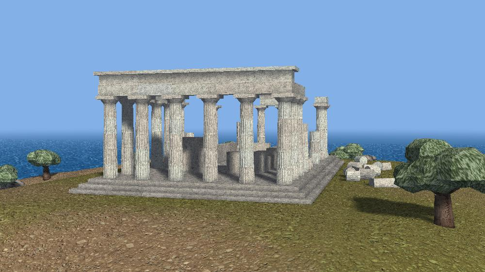
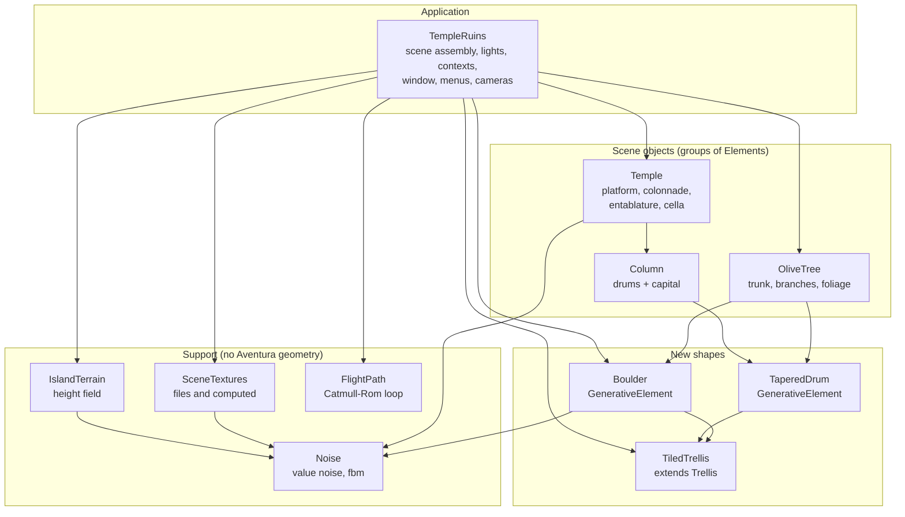
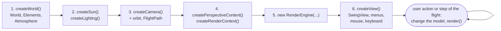
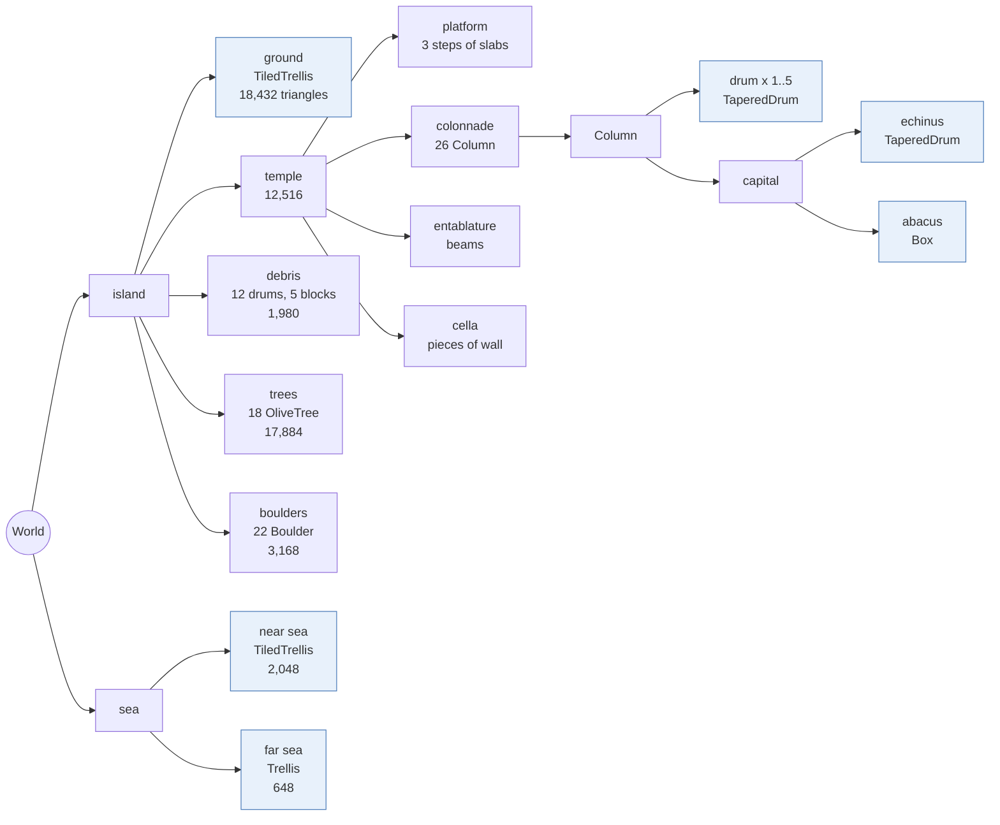
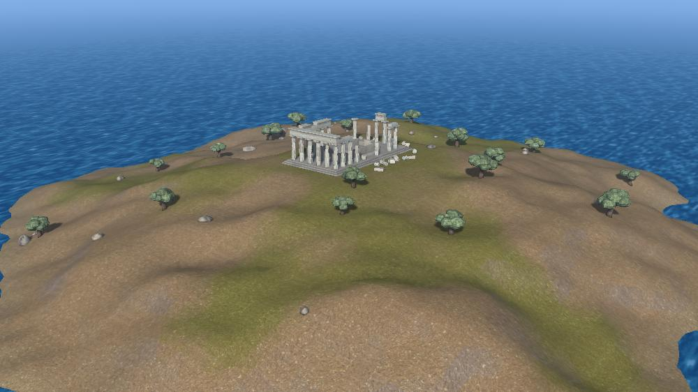
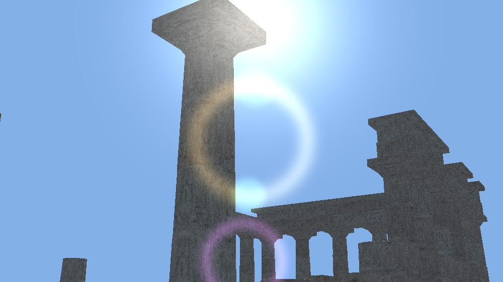
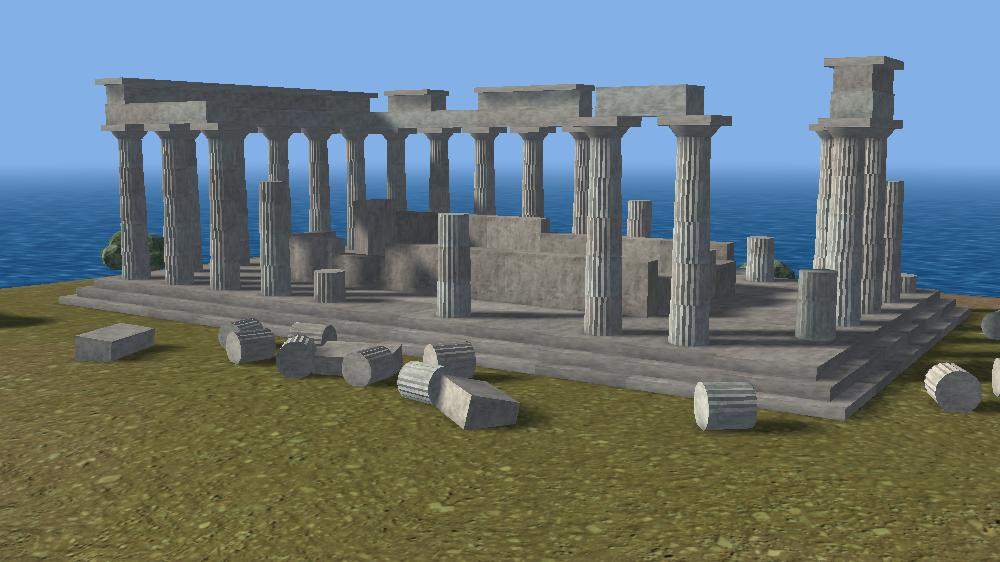
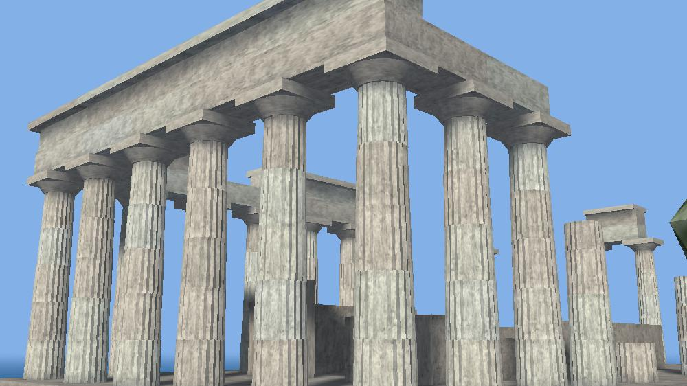
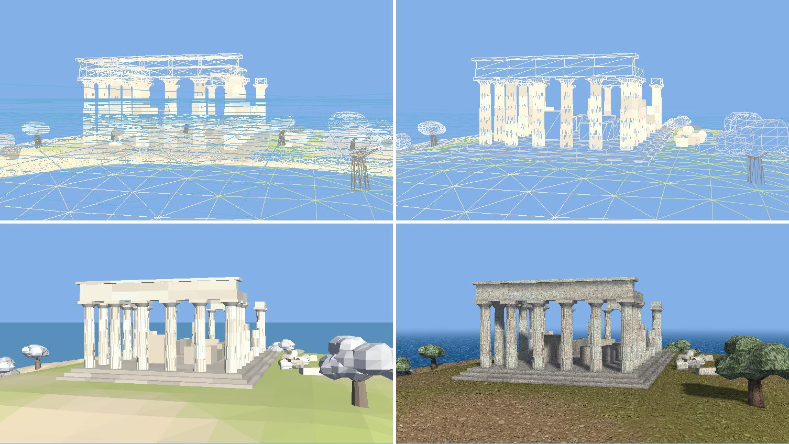

# TempleRuins — The Making of a Demo

> How the `TempleRuins` demo was built: its architecture, its graphic design, the tricks and the design choices
> behind it, its user interface, what could be added, its limitations (those of the demo and those of the
> engine) and its performance.
> For the engine itself, see the [Design Overview](DESIGN.md); for the recipes of a new shape, the
> [Geometry Cookbook](GEOMETRY_COOKBOOK.md).

<p align="center">
  <br/>
  <em>The demo as it starts: the main front of the temple, lit by the sun.</em>
</p>

| | |
|---|---|
| **What** | The ruins of a Doric temple on a small island, among olive trees and boulders, the sea up to the horizon, the sun halfway up the sky |
| **Where** | `com.aventura.demo.temple` (11 classes, about 3,500 lines, comments included), tests in the same package of `src/test` |
| **Run** | `mvn test-compile exec:java -Dexec.mainClass=com.aventura.demo.temple.TempleRuins` (from the project root) |
| **Scene** | 753 `Element`s, 56,676 triangles, 36,397 vertices, 4 image textures and 3 computed ones (35.5 MB), 1 sun, 1 ambient light, haze and optional mist |
| **Cameras** | Orbit, fly, and a helicopter tour of 516 m flown in 57 s |
| **Speed** | 42 to 145 ms per image (7 to 24 images per second) on a laptop, 94 ms on average over the helicopter tour, at 1000 x 562 pixels |
| **Engine changes** | `ShadowingLight.setShadowingElement()` (shadow map limited to an Element) and a depth rule in `shadowFactorAt()`; `GeometryStatistics` and `GeometryReport` (the size of a scene), the name and the memory of a `Texture` |

## Contents

1. [Goals](#1-goals)
2. [How it was created](#2-how-it-was-created)
3. [Architecture](#3-architecture)
4. [Graphic design](#4-graphic-design)
5. [Subtleties, tricks and design choices](#5-subtleties-tricks-and-design-choices)
6. [User interface](#6-user-interface)
7. [Tests and documentation images](#7-tests-and-documentation-images)
8. [Features that could be added](#8-features-that-could-be-added)
9. [Limitations](#9-limitations)
10. [Performance](#10-performance)

---

## 1. Goals

The demo had four goals, in this order when they conflicted:

1. **Look good.** A scene that makes someone want to try the engine: a recognizable subject, real textures,
   shadows, a sun in the sky, a horizon.
2. **Teach.** The code is meant to be read. Each class shows one thing the API can do, with the reason for each
   choice in its comments. A trick that would have needed a paragraph of apology was left out.
3. **Use the API as it is.** Everything is done through the public API: no engine class is subclassed to work around
   it, with one exception that turned out to be a missing feature of the engine (see
   [§5](#shadows-limited-to-the-island)).
4. **Stay interactive.** The dynamics of `FractalLandscape` (orbit and fly cameras, menus that switch each effect) plus
   an automatic flight, on a scene twice as heavy.

What the demo shows of the API:

| API feature | Where in the demo |
|---|---|
| Tree of `Element`s, three levels deep, with inherited colors | `Temple` > colonnade > `Column` > drums and capital |
| New shape from scratch (`GenerativeElement`) | `TaperedDrum`, `Boulder` |
| Built-in shape enriched by inheritance | `TiledTrellis extends Trellis` |
| Built-in shapes | `Box` (slabs, beams, walls, abacus), `Disc` (caps), `Trellis` (far sea) |
| Smooth and flat normals, on the same shape | `TaperedDrum` (smooth trunk, fluted column), `Boulder` (rock, foliage) |
| Texture coordinates per triangle | `TiledTrellis`, `TaperedDrum`, `Boulder` |
| `Translation`, `Rotation`, `Scaling`, and their composition | `OliveTree.pose()`, foliage and boulders, fallen drums |
| Textures from files, read in either direction | `SceneTextures` (marble, ground, rock; bark with its axes exchanged) |
| Textures computed pixel by pixel | `SceneTextures.createSea()`, `createFoliage()`, `shrink()` |
| Mipmapping of the textures (`RenderContext.setMipmapping()`) | `createRenderContext()`, Effects menu |
| Colors per triangle, tinting a texture | `TempleRuins.colorGround()` |
| `DirectionalLight` with color, soft shadows (`PCF_3X3`), shadow box | `TempleRuins.createSun()` |
| Colored `AmbientLight`, specular highlights per surface | `createLighting()`, `createSea()` |
| Visible sun: disc, halo, lens flare, light shafts (`LightAppearance`) | Effects menu |
| `Atmosphere`: `Haze` (model, max factor) and `SphericalFog` | `createAtmosphere()`, `createMist()` |
| The five rendering types and the on/off options of `RenderContext` | Rendering and Effects menus |
| `PerspectiveContext`, resize modes, `GUIView.resize()` | `createPerspectiveContext()`, `resizeView()` |
| `Camera.updateCamera()` with a tilted up vector | Helicopter tour (banking) |
| Off-screen rendering in an `ImageView` | `TestTempleRuins`, `DocumentationImages` |
| Statistics of a scene (`GeometryStatistics`, `GeometryReport`) | Camera menu, through the `StatisticsWindow` shared by the demos |

---

## 2. How it was created

The demo was written in one go, in this order, each step checked on images rendered off-screen (an `ImageView`, no
window) before going further.


**The first image was wrong in instructive ways.** What the first renderings showed, and what was changed:

| What the image showed | Cause | Change |
|---|---|---|
| A brown, noisy temple | The wrong image file for the marble | `texture_stone_1023x852.jpg`, a gray-white stone, tinted warm by the color of the Elements |
| A dark line across the sea | Sea beyond the far plane of the shadow box read as shadowed | A depth rule in the engine ([§5](#shadows-limited-to-the-island)) |
| No haze except in the last pixels before the horizon | From 25 m above the sea, everything beyond 1 km is squeezed into 26 rows of pixels | Visibility of the haze cut from 2,600 m to 1,100 m ([§5](#a-horizon-without-a-sky)) |
| Long light streaks forming X shapes on the sea | The photograph of the sea has remarkable details, which the mirrored tiling repeats | A computed texture, without any remarkable detail |
| Trees like bunches of balloons, trunks like barrels | Smooth shading on large blobs; the planks of the bark image are horizontal | Faceted foliage, more and smaller clumps; the bark image read with its axes exchanged |
| Flat, dark faces in the shade | Only the ambient light reaches them | Ambient raised (0.34 to 0.46) and tinted blue, sun lowered (0.9 to 0.82) |
| Thin lines of sky at the joints of a column | Two surfaces that only touch along a line | Each part goes 12 mm into the one below ([§5](#the-temple)) |
| Light shafts washing out the whole image | Most of the image is open sky | Off by default, at 30% when switched on |
| A white sea when the textures are switched off | The tint of the sea was white, its color being all in the texture | The color is in the tint, the texture only shades it ([§5](#textures)) |

**What was dropped.** A pediment (it needs a prism shape: one more class for a part most ruins have lost), point lights
as braziers (six shadow maps each, and no way to exempt a light from the shadows), a textured sea up to the horizon
(it flickers), a sky dome (it would be shaded by the sun like any object).

**Checking without a window.** Three scratch programs were used and not kept: one that renders a list of camera
positions and the whole tour to image files with the timing of each image, one that counts the triangles of each
branch of the scene, and one that starts the real application on a virtual display and clicks through every menu
item, drags the mouse and turns the wheel, to check that no action throws an exception. What they checked is now in the
unit tests and in `DocumentationImages` ([§7](#7-tests-and-documentation-images)).

---

## 3. Architecture

### Classes

One class per idea, each one readable on its own. The dependencies go one way: the application knows the scene
objects, which know the shapes, which know the noise.



| Class | Lines | Role | API shown |
|---|---|---|---|
| `TempleRuins` | 1,570 | The application: the six steps, the window, the cameras | Everything around the geometry |
| `Temple` | 340 | The ruin, built from a plan | Tree of Elements, `Box`, inherited colors |
| `Column` | 200 | A column, complete or broken; a fallen drum | Assembly by translation and rotation |
| `OliveTree` | 170 | A tree | Composition of transformations, `Scaling` |
| `TaperedDrum` | 240 | A section of a column or of a trunk | New shape, smooth or flat normals, sub-Elements as caps |
| `Boulder` | 190 | A rock or a clump of leaves | New shape, normals computed from the mesh |
| `TiledTrellis` | 140 | A ground with a repeated texture | Inheritance, texture coordinates per triangle |
| `IslandTerrain` | 180 | The altitudes of the island | (none: plain Java, feeds a `Trellis`) |
| `SceneTextures` | 190 | The six textures | `Texture` from a file and pixel by pixel |
| `FlightPath` | 170 | The path of the helicopter | `Vector4`, `Rotation` |
| `Noise` | 110 | Value noise and fractal noise | (none) |

`TaperedDrum` and `Boulder` use `TiledTrellis.mirror()`, the only link between shapes: the mirrored repetition of a
texture is the same idea on a ground, around a drum and around a boulder.

### The six steps

`TempleRuins.createScene()` follows the same steps as every Aventura application, one method per step, then
`createView()` adds the window:



Steps 1 to 5 are separated from the window on purpose: the tests and the documentation images create the scene and
render it in an `ImageView`, without Swing.

### The scene tree



The two roots are not an accident of the layout: `island` is what the sun casts shadows on, so it had to be one
Element ([§5](#shadows-limited-to-the-island)). The tree is also where colors flow: a `Column` gives its tint to
its capital, a drum to its caps, the `sea` group to its two surfaces.

---

## 4. Graphic design

<p align="center">
  <br/>
  <em>The whole island, as the helicopter sees it from the south-west.</em>
</p>

### Scale and layout

**One unit is one meter.** Every dimension can then be checked against the real thing (a Doric column about 5.8 m
high, a person's eyes at 1.7 m), and the numbers of the engine fall in comfortable ranges (near plane at 10 cm, far
plane at 5 km, shadow bias of 2 cm).

| Element | Size |
|---|---|
| Island | About 185 m across, in a square of ground of 240 m (cells of 2.5 m) |
| Plateau of the temple | 38 x 25 m, at 16 m above the sea, blended into the slopes over 16 m |
| Temple | 6 x 11 columns, 2.5 m apart; platform of 29 x 16.5 m on the ground, 0.96 m high |
| Column | 5 drums of 1.05 m, radius 0.52 m to 0.41 m, 20 flutes of 3 cm; 5.77 m with its capital |
| Olive tree | 4 to 7 m high |
| Sea | Textured over 800 m, plain up to 4.5 km |

By convention of the demo, X points east and Y north: the long side of the temple is along X and its main
front faces west (-X), where the sun is.

### Composition and light

The **sun** is at azimuth 212° and elevation 32°: over the sea, in front of the main front and to its left. It is
"halfway up": high enough to light the floor between the columns, low enough to cast shadows longer than the objects
and to be caught in the image when the camera looks up from behind the temple. The initial camera has the sun behind
its left shoulder, so the first image shows lit marble, sharp flutes and the shadow of the colonnade on the cella.

| Light | Color | Intensity | Role |
|---|---|---|---|
| Sun (`DirectionalLight`) | Warm white (255, 246, 228) | 0.82 | Shapes and shadows |
| Sky (`AmbientLight`) | Bluish (205, 222, 255) | 0.46 | The only light in the shade: blue shadows against warm lit faces |

The warm/cool contrast is the oldest trick of outdoor painting, and it costs nothing: the ambient light is a color,
not only an intensity.

<p align="center">
  <br/>
  <em>Against the light, from behind the temple: the disc of the sun, its halo and the ghosts of the lens flare.</em>
</p>

### Palette

| Surface | Texture | Tint (multiplied) | Result |
|---|---|---|---|
| Marble | Gray-white stone (file) | Warm white, ±7% per block | Weathered marble, each block distinct |
| Ground | Gravel (file) | Earth, dry grass, sand, rock, by altitude, slope and noise | Mediterranean scrub |
| Boulders | Cracked concrete (file) | Light gray, ±20% | Limestone |
| Bark | Old wood (file, turned) | Gray-brown | Olive trunk |
| Foliage | Computed | White, 82 to 100% per clump | Silver green |
| Sea | Computed | Medium blue | Deep blue with lighter wavelets |
| Sky | — | (132, 176, 232) | Also the color of the haze |

### The temple as a ruin

A ruin reads as a ruin through three things, all present: **incompleteness that follows a logic** (the main front is
intact, the damage grows towards the back and the south side), **debris near where it fell from** (the fallen drums
lie along the side with the missing columns), and **irregularity in what remains** (each drum has its own tint and
angle, each broken column its own height, the walls of the cella crumble in a continuous profile).

<p align="center">
  <br/>
  <em>The south side: broken columns, fallen drums and blocks, what remains of the walls of the cella.</em>
</p>

---

## 5. Subtleties, tricks and design choices

### Geometry

**Flutes without triangles for the curves.** A fluted drum has 40 faces around: the radius alternates between a
ridge and the bottom of a groove, 3 cm deeper. The grooves are V-shaped, not round, but each face keeps its own normal
(flat shading), so neighbor faces catch the light differently and the eye reads flutes. Round flutes would need four
times the triangles for a difference visible only from a meter away.

<p align="center">
  <br/>
  <em>At the foot of the main front: the drums and their tints, the flutes, the capitals, the three layers of the entablature.</em>
</p>

**One shape, two shadings.** `TaperedDrum` is smooth without flutes (normals of the ideal cone, set per vertex) and
faceted with them (the default normal per triangle). `Boulder` has the same switch: smooth for a rock, faceted for a
clump of leaves. Smooth foliage looked like balloons; the facets look like masses of leaves.

**Normals from the mesh itself.** A boulder has no formula for its normals. `Boulder.smoothNormals()` sums, at each
vertex, the cross products of the sides of the triangles around it, then normalizes: the cross product has the
direction of the normal and twice the area of the triangle as its length, so large triangles weigh more, as they
should. The method works for any mesh.

**One vertex at each pole.** A sphere built as a grid has a row of vertices at the same place at each pole, hence
triangles of zero area, whose flat normal is `NaN`. `Boulder` has a single vertex per pole and a fan of triangles
around it.

**Texture coordinates belong to the triangles.** This is what makes the three shapes simple: a vertex shared by two
faces can have a different texture coordinate in each, so no vertex is duplicated where a surface closes on itself or
where two tiles meet.

**Caps only where they can be seen.** A drum is a closed surface as far as back-face culling goes, but its two ends
are optional `Disc` sub-Elements. In a column, only the top of a broken shaft and the underside of the echinus have
one: 1 cap instead of 12 per complete column.

**The terrain is a formula.** `IslandTerrain.formula()` is a dome over a disc whose radius varies with a noise (the
coast), plus two fractal noises (hills, bumps) that fade out under the sea, blended towards a constant altitude near
the temple (the plateau). No file, no editor, and another seed is another island with the same plateau.

**Altitude: the higher of two answers.** A cell of the grid is drawn as two triangles, cut along one diagonal or the
other. `altitude()` computes both and returns the higher, so whatever is put on the ground, and the camera kept
above it, is never under the drawn surface. The idea comes from `FractalLandscape.groundAltitude()`.

### Textures

**Mirrored tiling.** Aventura's texture coordinates stop at 1 (the border is repeated beyond). To repeat a texture
over 240 m of ground, every other tile is mirrored: the coordinate goes 0 to 1, then 1 to 0. Two neighbor tiles then
show the same pixels along their common border, so **any image tiles without a seam**. The price: a remarkable detail
of the image appears twice, face to face, which is why the photograph of the sea was replaced.

```
 tile:        0        1        2        3
 u:       0 ------> 1 ------> 0 ------> 1 ------> 0
```

**The color is in the tint, the detail in the texture.** The engine multiplies the color of a surface by its texture.
The sea Element is blue and its texture goes from a dark shade to almost white: with the textures switched off, the
sea is still a sea. The same marble image gives each block its own tint for one line of code.

**A texture of one pixel.** The far sea has the same tint as the near one and a texture that is the average color of
the sea texture (`shrink()` down to a single pixel). The two seas therefore match with the textures on, and with them
off, without any special case.

**Small slabs instead of a large box.** A `Box` maps its texture once on each face. A floor of 27 x 15 m in one box
would stretch the image over the whole temple. The platform is paved with one slab per column spacing: a sharp
texture, a tint per slab, and joints, for 126 boxes and 1,500 triangles.

**The sea does not flicker much.** The demo was written when the engine had no mipmaps: when several pixels of a
texture fell in one pixel of the screen, 4 of them were read, and they changed with the slightest move of the camera.
Hence a sea texture of 512 pixels for 25 m (5 cm per pixel), with long, soft wavelets, and a plain color beyond 400 m.

**Mipmapping, added for this demo.** The ground and the marble showed the problem the sea had avoided: sharp from
close, they turned into a grainy noise in the distance, all the more visible next to the clean edges of the geometry,
and it flickered during the flight. A texel of the ground is 2 cm wide; at 300 m a pixel covers 30 cm of ground,
some 200 texels, of which 4 were read. The engine now keeps smaller and smaller copies of each texture (its mipmaps,
each texel the average of 4 texels of the level below) and reads the one whose texels have the size of the pixel
(`RenderContext.setMipmapping(true)`, see [DESIGN.md §5](DESIGN.md#5-rasterization-and-fragments)). Nothing changes
from close. Switch "Mipmapping" off in the Effects menu to compare.

**Leaves from two noises.** The foliage texture mixes a fine noise stretched in one direction (the leaves) and a
coarse one (areas more green or more silver), through three colors: 256 x 256 pixels, computed at start-up.

### The temple

**The ruin is a map.** `Temple.PLAN` is six strings: `C` a complete column, `1` to `4` the number of drums left, `.`
nothing. The colonnade and the entablature are derived from it: there is a beam wherever two neighbor columns are
complete. Editing the strings rebuilds another ruin.

```java
static final String[] PLAN = {
        "CCCCCC3.2C1",
        "C.........4",
        "C.........C",
        "C.........C",
        "C.........2",
        "CCC41.3.CC.",
};
```

**A broken column is the same column, with fewer drums.** Like the ancient ones, a column is a stack of drums. The
last drum of a broken one is shorter by a random amount and has a cap. A fallen drum is the same drum again, with two
caps and a quarter turn.

**No coplanar faces.** Two faces at the same place flicker, the depth test choosing one or the other from pixel to
pixel (z-fighting). Three places needed care: at a corner of the temple, the beams of the fronts are made longer and
those of the long sides shorter, each layer by half its own width; the short walls of the cella fit between the long
ones; the far sea is half a meter under the near one.

**No lines of sky.** Two separate meshes that touch along a line do not share vertices, and the rasterizer can leave a
gap of a pixel between them. Each part of a column goes 12 mm into the one below, and whatever lies on the ground is
sunk a little.

**Walls that crumble.** The height of each piece of wall of the cella is a number of courses taken from a noise along
the wall, not a random number: neighbor pieces have close heights.

**Seeds.** Every random choice comes from a `Random` with a fixed seed (temple, debris, trees, boulders, mist). The
scene is the same at each run, which makes it testable, and changing a seed gives other trees with the same code.

### A horizon without a sky

The engine draws the sky as a single background color, and a sea that stops somewhere would show its edge against it.
Three choices make the horizon:

- The **far sea** is a `Trellis` of 9 km with cells of 500 m. The engine clips the triangles that cross the near
  plane, so large cells are not a problem.
- The **haze** uses the `EXPONENTIAL_SQUARED` model, which leaves the air clear near the camera (1% at 60 m, the
  temple; 5% at 150 m) and thickens fast (60% at 600 m), with a visibility of 1,100 m.
- Its **maximum factor is 1** instead of the default 0.95: far enough, the sea *is* the color of the haze, which by
  default is the background color. The sea ends in the sky without a line.

The visibility looks short for a clear day. It has to be: from 25 m above the water, the sea between 1 km and the
horizon covers 26 rows of pixels. A realistic visibility of 20 km would put the whole fade in the last row.

### Shadows limited to the island

By default the shadow map of a `DirectionalLight` covers the whole World: here 9 km of sea, that is 4.5 m per texel
for a map of 2,048 pixels. The columns, 1 m wide, would cast no shadow.

The backlog had the answer as a constant never implemented, `SHADOWING_BOX_ELEMENT`. It is now:

```java
sun.setShadowingElement(island);   // The shadow map covers the bounding box of this Element only
sun.setShadowMapSize(2048);        // About 15 cm per texel on the island
sun.setShadowFilter(ShadowFilter.PCF_3X3);
```

This is the reason for the `island` group in the scene tree. Two things were added to the engine:

- `ShadowingLight.setShadowingElement(Element)` and the `SHADOWING_BOX_ELEMENT` case of `DirectionalLight`: the box
  of the light is fitted on the world-space bounding box of the Element and its sub-Elements, at each frame.
- In `shadowFactorAt()`, a point whose depth is out of the box of an orthographic light (in front of it or beyond it)
  is lit, like a point out of it sideways. Without this rule, the sea beyond the far plane of the box was compared
  with the "nothing here" value of an empty texel and read as shadowed: a dark band on the water. With the box of the
  whole World, nothing was ever beyond it, so the case never happened.

Both are covered by `TestShadowingElement`.

### Transformations

**A pivot is a translation first.** A `TaperedDrum` is created upright, centered on its origin. A branch must turn
around its base: `OliveTree.pose()` moves the drum up by half its length, tilts it, turns it to its heading, then
moves it to the top of the trunk. Written as one product of matrices, in the reverse order of application:

```java
new Translation(base)
        .times(new Rotation(heading, Vector3.zAxis()))
        .times(new Rotation(tilt, Vector3.yAxis()))
        .times(new Translation(Vector3.zAxis(), length / 2))
```

**The same matrix places the next part.** The top of the trunk, where the branches start, is the pose of the trunk
applied to the top of the upright drum (`trunkPose.times(point)`). Nothing is computed twice in two different ways.

**Scaling that distorts.** The clumps of foliage are flattened by 30% and the boulders stretched at random on each
axis. A non-uniform `Scaling` bends the normals; the engine corrects them (the normal matrix of
`ElementTransform`), so no special care is needed in the demo.

### The helicopter tour

**A spline through the waypoints.** `FlightPath` joins 9 waypoints by a closed Catmull-Rom spline: a cubic curve
between two waypoints, whose direction at each one is parallel to the line between its two neighbors. It goes through
every waypoint without a change of direction, and needs only the points. The eye and the target each have their
spline.

**Constant speed, whatever the computer.** The position on the path is a distance travelled, advanced at each image by
the speed times the time elapsed since the previous image. A slow computer shows fewer images of the same flight. The
elapsed time is capped at half a second, so an exceptionally long image slows the flight down instead of making the
camera jump.

**Banking.** The up vector of the camera is the vertical turned around the line of sight, by an angle proportional to
how fast the path turns (3° per degree of turn per meter, 6° at most). It is the only place where the camera does not
use Z as its up vector, and it shows that `Camera.updateCamera()` takes any up vector.

**Taking the controls.** A drag of the mouse or a notch of the wheel during the tour switches to the fly camera, from
where the camera is, looking where it looks. Going back to the tour resumes it from where it was left.

**The tour is tested.** `TestTempleRuins` samples the path every 50 cm and checks that the camera is at least 1.7 m
above the ground and the sea, and never inside the temple. Moving a waypoint into a column fails the build.

### Lights and effects

**A wide highlight on the sea.** A flat sea has a single normal, so its specular highlight is one spot, only visible
when the camera looks at the mirror image of the sun. With a low exponent (25) the spot is wide, and the whole sea
gets brighter towards the sun, which is what a sea does.

**Light shafts at 30%.** They are computed from the visible sky, and here most of the image is sky. The Effects menu
switches them through `LightAppearance.setShaftsGain(0.3f)` rather than `RenderContext.setLightShafts(true)`, which
forces them on at full strength for a sun that has none.

---

## 6. User interface

The window, the menus and the mouse and keyboard handling follow `FractalLandscape`, on purpose: the same gestures,
the same menu layout, and code a reader of one demo recognizes in the other.

### Cameras

| Mode | Key | Mouse drag | Wheel, `Up` / `Down` |
|---|---|---|---|
| Orbit (default) | `O` | Turn around the temple (never up to the vertical) | Zoom, between 6 m and 600 m of the temple |
| Fly | `F` | Look around | Fly forward / backward along the line of sight, at least 1.7 m above the ground and the sea |
| Helicopter tour | `H` | Take the controls (switches to Fly) | Take the controls (switches to Fly) |

A touchpad works like the wheel (two-finger scroll, pinch), including fractions of a notch. The wheel does not move
the camera at once: the movement eases over 150 ms.

### Menus

| Menu | Item | Key | Effect |
|---|---|---|---|
| Camera | Orbit camera / Fly camera / Helicopter tour | `O` / `F` / `H` | The camera mode (radio buttons) |
| | Pause / resume the tour | `Space` | Freezes the flight where it is |
| | Reset camera | `R` | Initial orbit, start of the flight, or first waypoint of the tour |
| | Statistics | `I` | The size of the scene and the work of the engine for the last image, in a window and in the console ([below](#statistics)) |
| Sun | Higher / Lower | `Page Up` / `Page Down` | Elevation of the sun by 5°, between 5° and 85° |
| | Turn left / Turn right | `Left` / `Right` | Azimuth of the sun by 5° |
| | Reset sun | | Back to 212°, 32° |
| Rendering | Lines, Monochrome, Unlit, Flat, Shading | | The `RenderingType` (radio buttons) |
| Effects | Textures, Mipmapping, Specular highlights | | Surfaces; mipmapping smooths the textures seen from far away |
| | Shadows, Soft shadows | | Shadow map of the sun, hard or `PCF_3X3` |
| | Haze, Sea mist | | The two branches of the `Atmosphere` |
| | Sun, Sun halo, Lens flare, Light shafts | | The visible sun and its `LightAppearance` |

<p align="center">
  <br/>
  <em>The Rendering and Effects menus on the initial view: lines, monochrome, flat shading without textures, shadows nor atmosphere, and the full rendering.</em>
</p>

The effects that the current rendering type does not use are grayed out, and so are the sub-options of an option that
is off. The title of the window shows the camera mode and the time taken by the last image, in milliseconds: the
simplest performance meter, always in view. During the helicopter tour, it also shows the average, fastest and
slowest times of the last lap (see [Statistics](#statistics)).

### Statistics

The Statistics item of the Camera menu (key `I`) opens a window that does not block the demo (the tour goes on behind
it) with the size of the scene and what the engine did of it for the last image. The same text is printed in the
console, and once more when the window of the demo is closed.

```
Temple ruins - statistics

GEOMETRY                                  elements   triangles    vertices   share
World                                          753      56,676      36,397  100.0%
  island                                       750      53,980      34,947   95.2%
    ground (TiledTrellis)                        1      18,432       9,409   32.5%
    temple                                     396      12,516      11,770   22.1%
      platform                                 127       1,512       1,008    2.7%
        box x 126                              126       1,512       1,008    2.7%
      colonnade                                217      10,416      10,370   18.4%
        column x 26                            216      10,416      10,370   18.4%
          drum (TaperedDrum) x 110             118       9,120       9,128   16.1%
            disc x 8                             8         320         328    0.6%
          capital x 18                          72       1,296       1,242    2.3%
            drum (TaperedDrum) x 18             36       1,080       1,098    1.9%
              disc x 18                         18         360         378    0.6%
            box x 18                            18         216         144    0.4%
      entablature                               33         384         256    0.7%
        box x 32                                32         384         256    0.7%
      cella                                     18         204         136    0.4%
        box x 17                                17         204         136    0.4%
    debris                                      42       1,980       1,984    3.5%
      drum (TaperedDrum) x 12                   36       1,920       1,944    3.4%
        disc x 24                               24         960         984    1.7%
      box x 5                                    5          60          40    0.1%
    trees                                      287      17,884      10,156   31.6%
      olive tree x 18                          286      17,884      10,156   31.6%
        drum (TaperedDrum) x 107               107       1,784       1,784    3.1%
        boulder x 161                          161      16,100       8,372   28.4%
    boulders                                    23       3,168       1,628    5.6%
      boulder x 22                              22       3,168       1,628    5.6%
  sea                                            3       2,696       1,450    4.8%
    near sea (TiledTrellis)                      1       2,048       1,089    3.6%
    far sea (Trellis)                            1         648         361    1.1%
7 levels of Elements, 72 of them without triangles of their own (groups)

TEXTURES                                                        pixels      memory   triangles
  texture_ground_stone_600x600.jpg                           600 x 600      1.8 MB      18,432
  texture_stone_1023x852.jpg                                1023 x 852      4.4 MB      14,496
  texture_barnwood_576x358.jpg                               358 x 576      1.0 MB       1,784
  foliage (computed)                                         256 x 256    341.3 KB      16,100
  texture_gray_concrete_wall_with_cracks_2748x2748.jpg     2748 x 2748     38.4 MB       3,168
  sea (computed)                                             512 x 512      1.3 MB       2,048
  sea, average color                                             1 x 1         4 B         648
  (no texture)                                                                               0
7 textures                                                                 47.4 MB      56,676

LAST IMAGE (1000 x 562 pixels, Helicopter tour)
Frame 208.9 ms (SETUP 3.1, SHADOWS 42.1, GEOMETRY 10.4, MAIN_PASS 148.3, OVERLAYS 4.9, PRESENT 0.1)
Render Engine - Processed: elements: 753, triangles: 56676. Triangles: displayed: 31521, not displayed: 25155, backfacing: 16285
```

Nothing of this is specific to the demo. It is made of three generic layers, the first two added to the API for
the occasion (the counters of `World` did not go down the tree of its Elements):

| Layer | Class | What it gives |
|---|---|---|
| Numbers | `GeometryStatistics` (`model.world`), from `World.getStatistics()` or `Element.getStatistics()` | Elements, groups, triangles, vertices, depth of the tree, textures used and their triangles, for a World, a branch or a list of Elements. `Texture.getName()` and `getMemorySize()` complete it. |
| Text | `GeometryReport` (`model.world`) | The table above, for any World or Element: the sub-Elements of the same kind (same class, same name) are gathered on one line, so a scene of 753 Elements fits in about thirty lines |
| Window | `StatisticsWindow` (`com.aventura.demo`) | The menu item, the window, the console, the print at closing, and the part about the last image (`RenderEngine.getFrameTimer()` and `renderStats()`), for any demo with a Swing window, in three lines |

```java
statistics = new StatisticsWindow(frame, TITLE, world, renderer);
menu.add(statistics.createMenuItem());   // "Statistics", key I
statistics.printOnClose();
```

The only things the demo does for its statistics are to **name** what has no telling name: the ground and the two
seas (a `Trellis` is called "trellis" by default) and the computed textures (which have no file name).

**What the statistics showed at once.** The foliage is 28% of the triangles, more than the whole temple with its
platform (22%); and the texture of the boulders is 81% of the texture memory (38.4 MB, mipmaps included: one third more than the texture alone) for 5.6% of the triangles, drawn on
rocks that seldom cover more than a few hundred pixels. Both are in the list of [§10](#10-performance).

**Rendering times, lap by lap.** The time of one image, in the title of the window, changes with what the camera
sees and from an image to the next: it cannot tell whether an option costs or saves a few percent. The helicopter
tour can: always the same path, at the same speed. At the end of each lap, the demo prints the number of images and
their average, fastest and slowest rendering times, with the options in force:

```
HELICOPTER TOUR, LAP 2 (1000 x 562 pixels, INTERPOLATE, textures, mipmapping, specular highlights, shadows, soft shadows, haze, sun, sun halo, lens flare, sun at 212 / 32 degrees)
412 images in 31.2 s (13.2 per second), rendering: average 71.4 ms (14.0 per second), fastest 38.2 ms (26.2), slowest 124.9 ms (8.0)
```

(the figures of this example are made up). The first rate is what is displayed, the second what the engine renders:
the display of the image and the pace of the timer make the difference. The average of the last lap also stays in
the title of the window, and the report is added to the statistics. To compare two options, fly one whole lap with
each: change the option, wait for the end of the lap under way (reported with a warning, since it mixes the two),
then read the next one. A lap entered on the way (after a visit in another camera mode) is not reported, and the
first lap after start-up is a little slower than the next ones, while the Java virtual machine compiles the code.
The counting is `FrameTimeStatistics` (`com.aventura.demo`), usable by any demo, and
`StatisticsWindow.setExtraSection()` adds such a text to the report.

### How it is built

- **Closing the window stops the timers.** A Swing `Timer` still running would keep the application alive after its
  window is gone, rendering images that nobody sees.
- **Every action changes the model, then renders.** A menu item is a lambda on the `RenderContext`, the `Lighting`,
  the sun or the `Atmosphere`, followed by `render()`. Nothing else is kept in sync, except the menu itself.
- **The menus start from the model.** Each check box takes its initial state from the object it controls, so the
  defaults live in one place (`createRenderContext()`, `createSun()`...).
- **Keys are menu accelerators** wherever a menu item exists, so the menus document the keyboard. The two arrow keys
  without an item are bound to the root pane (`WHEN_IN_FOCUSED_WINDOW`), which works whatever component has the focus.
- **Moving the sun is one call**, `sun.setLightVector()`: the engine computes the shadow map again at the next frame
  and draws the disc at its new place.
- **One `updateCamera()`** places the `Camera` from the state of the current mode; the modes only differ by the state
  they keep (angles and distance, position and angles, distance travelled).
- **Timers, not threads.** The tour and the easing of the wheel are Swing `Timer`s: their steps run on the Swing
  thread, like the mouse events, so there is nothing to synchronize. A timer does not queue more than one step, so a
  slow rendering does not pile up work.
- **Resizing** waits 50 ms after the last change of size, then resizes the view (`GUIView.resize()`); the
  `PerspectiveContext` keeps its scale (`KEEP_SCALE`), so a larger window shows more of the scene.
- **The geometry helpers are static and package-private** (`orbitEye()`, `lineOfSight()`, `advance()`,
  `groundColor()`...), so that they are tested without a window.

---

## 7. Tests and documentation images

| Test class | Tests | What it checks |
|---|---|---|
| `TestTempleGeometry` | 13 | Noise (bounded, continuous, deterministic), mirrored tiles, the three shapes against the contracts of the Geometry Cookbook (`ElementContractChecker`: vertices, normals, winding through the enclosed volume), `Column`, `Temple` against its plan, the terrain (an island, a flat plateau), the flight path (through its waypoints, closed, continuous, banking to the inside) |
| `TestTempleRuins` | 9 | The pure functions of the application, the computed textures, the content of the scene and its statistics, the tour (above the ground, out of the temple), and a rendering in an `ImageView` (sky, ground, marble in the sun and in the shade, shadows that change the image) |
| `TestGeometryStatistics` (`model.world`) | 8 | `GeometryStatistics` and `GeometryReport` on a small tree of boxes: counts of a branch, of a World, of a list; textures counted once; the lines of the report; the counters of `World`; name and memory of a `Texture` |
| `TestStatisticsWindow` (`demo`) | 1 | The text of the statistics on a scene that is not a demo, without a window |
| `TestShadowingElement` (`model.light`) | 4 | The shadow box of an Element: the setter, the size of the box, the shadow of a small object in a large World, and the points out of the box, which are lit |

The images of this page are rendered by `DocumentationImages`, like the others of the documentation, from the scene
of the demo and fixed camera positions:

```
java -Djava.awt.headless=true -cp target/classes:target/test-classes com.aventura.demo.DocumentationImages \
     resources/doc/images temple_ruins.jpg temple_ruins_colonnade.jpg temple_ruins_debris.jpg \
     temple_ruins_sun.jpg temple_ruins_island.jpg temple_ruins_rendering.jpg
```

---

## 8. Features that could be added

In the demo, with the engine as it is:

| Feature | How | Effort |
|---|---|---|
| Walk mode | The fly camera kept at eye height above `IslandTerrain.altitude()`, the platform included | Small |
| Collisions with the temple | Circles around the columns and rectangles around the walls, tested like the ground | Small |
| Time of day | The Sun menu as an animation, with the color and intensity of the sun and of the sky following the elevation (red and low, white and high) | Small |
| New island | A menu item that changes the seed of the terrain and rebuilds the World, as `FractalLandscape` does | Small |
| Edit the ruin | Keys that raise or pull down a column: change `PLAN`, rebuild the temple | Small |
| Pediment | A triangular prism (a new `GenerativeElement`) on the main front | Small |
| More vegetation | Cypresses (a `TaperedDrum` and a stretched `Boulder`), bushes, tufts of grass | Small |
| A ground mist | The `GroundMist` of the Atmosphere Cookbook, lying in the hollows of the island | Small |
| Tour editor | Record the waypoints of a tour from the fly camera, save and replay them | Medium |
| Record the tour | Render the tour to numbered images at a fixed time step, for a video | Small |
| Statues, an altar, a boat | New assemblies; a model read from a file once the engine can ([MODEL_FILE_IO.md](MODEL_FILE_IO.md)) | Medium |
| Shared camera controls | The orbit and fly cameras are now written twice (`FractalLandscape`, `TempleRuins`): a common class would serve every demo | Medium |

With an evolution of the engine: see the table of the next section.

---

## 9. Limitations

### Of the demo

- **No collision with the temple.** The fly camera stays above the ground and the sea, but goes through the columns
  and the walls (the near plane then cuts them open).
- **The trees are stylized**: a dozen faceted blobs each. They read as olive trees at 20 m, not at 2 m.
- **The shore is a straight cut** of the ground by the sea plane, along triangles of 2.5 m: no foam, no shallow
  water, no beach profile beyond a lighter tint.
- **The ground colors change by triangle**, which shows as faint facets where the tint varies fast, and plainly when
  the textures are off.
- **The temple is a model, not a reconstruction**: no pediment, no triglyphs, no entasis, cylindrical drums stacked
  with straight sides, a cella without a floor plan.
- **The sea does not move**, and neither do the trees.
- **The rendering runs on the Swing thread**: the window does not respond during an image (see
  [§10](#10-performance)).
- **Textures are read from `resources/texture`**, relative to the directory the program is run from: the demo must be
  started from the project root.

### Of the engine, as met by the demo

Each of these shaped the demo. They are listed with what the demo did about it and what the engine could offer; some
are already in the [backlog](BACKLOG.md) or in the [performance audit](PERFORMANCE_AUDIT.md).

| Limitation of the engine | Effect on the demo | Possible evolution |
|---|---|---|
| The sky is a single color | No gradient towards the horizon, no clouds; the haze does the job of the horizon | A sky gradient (zenith and horizon colors), then a sky texture or procedural clouds |
| No surface without lighting inside a lit scene | No sky dome, no emissive object (a fire, a lamp) | An "unlit" or emissive flag per Element or per material (backlog §3b: emissive geometry) |
| Texture coordinates clamped to [0, 1] | Mirrored tiling, written three times in three shapes | Wrap modes on `Texture`: clamp, repeat, mirror |
| Mipmaps without anisotropic filtering | The ground seen at a low angle is a compromise: slightly soft far away, to avoid the noise | Several samples along the stretched direction of the pixel (backlog §4) |
| No transparency (alpha) | Foliage as solid blobs, opaque water without a sea bed | Alpha test first (leaves as textured cards), then blending |
| Materials are chosen by the engine (`SolidMaterial`, `TexturedMaterial`); an Element cannot be given its own | No water material (Fresnel, moving ripples), no triplanar rock | `Element.setMaterial(Material)`: the `Material` interface already exists |
| No bump or normal map (backlog §2) | Flutes as geometry; flat walls, flat water | Normal maps |
| Colors per triangle, not per vertex | Faceted tints of the ground | A color per vertex, interpolated like the normals |
| A `Box` maps its texture once per face | The platform paved with 126 small boxes | Texture repetition per face, given in world units |
| The ambient light is constant | Faces in the shade are flat, whatever their direction | A hemispheric ambient (sky above, ground below), or ambient occlusion |
| Every `ShadowingLight` casts shadows, when shadows are on | No fill light, no point lights as braziers (six maps each) | A `castShadows` switch per light (backlog §3) |
| The shadow map is computed again at each frame | 45 to 75 ms per image for a sun and a scene that do not move | A cache with a change flag (backlog §3, audit R9) |
| One shadow map for the whole island | 15 cm per texel: fine at 20 m, soft at 2 m | A box fitted on the view frustum, or cascades |
| `SHADOWING_BOX_SPECIFIC` not implemented | The shadow box had to be an Element of the scene tree | A box given by its corners |
| The haze has one color and ignores the sun; the sun and its halo are not dimmed by the haze or the fog | No warm glow towards the sun, a sharp sun through the mist | Backlog §5b |
| The same geometry cannot be shared by several Elements | 26 columns, each with its own vertices and triangles | Instancing: one mesh, many transformations (audit D4) |
| No camera controller in the API | Orbit and fly cameras written in the demo | A small `camera` toolbox: orbit, fly, path |
| Textures loaded from file paths only | Run from the project root | Loading from the classpath (roadmap) |

---

## 10. Performance

### Measures

**In the application.** Measured by the author on his laptop, in the window of the demo (996 x 558 pixels drawn),
with the options it starts with (textures with mipmapping, soft shadows, haze, visible sun), over whole laps of the
helicopter tour: the rendering times that the demo reports at the end of each lap (see [Statistics](#statistics)).
A lap is 57 s and about 530 images.

| Lap | Mipmapping | Average | Fastest image | Slowest image | Images displayed per second |
|---|---|---|---|---|---|
| 1 (the Java virtual machine warms up) | on | 94.2 ms (10.6 per second) | 44.8 ms (22.3) | 179.0 ms (5.6) | 9.3 |
| 2 | on | 95.9 ms (10.4 per second) | 50.0 ms (20.0) | 141.4 ms (7.1) | 9.2 |
| 3 | on | 91.4 ms (10.9 per second) | 41.6 ms (24.0) | 145.2 ms (6.9) | 9.5 |
| 1, in another run | off | 89.9 ms (11.1 per second) | 48.8 ms (20.5) | 150.6 ms (6.6) | 9.7 |

The fastest images are the views very close to the temple, the slowest the wide shots, where the ground and the sea
fill the image with lit, textured and shadowed pixels and almost every triangle of the scene is in the view. The
flight is fluid near the temple and still readable in the wide shots.

Two lessons. The laps differ by up to 5% with the same options: a single image, or a single lap, cannot settle a
difference of a few percent. And the mipmapping costs about that much at most (2 to 6 ms per image on average,
within the variation from lap to lap), for an image without noise nor flicker in the distance.

**Stage by stage.** Measured on the 18 images of a lap of the tour, at the same size, rendered off-screen on a much
slower computer (a **2-core** virtual machine with JDK 21, whose times are two to three times longer): take the
proportions between the stages rather than the values.

| Stage | Time per image | Depends on |
|---|---|---|
| Shadow map of the sun | 45 to 75 ms | The size of the map (2,048 pixels) and the 54,000 triangles of the island; not the camera |
| Geometry (transform, culling, clipping) | 5 to 13 ms | The 56,676 triangles |
| Main pass (rasterization and shading) | 40 to 215 ms | The pixels covered by lit, textured, shadowed surfaces: lowest when the sky fills the image, highest in the views from above |
| Atmosphere and visible sun | 5 to 25 ms | The sun in the image or not |
| **Whole image** | **120 to 290 ms** | |

Switching the shadows off removes about a third of the time, the textures about a sixth. Of the 56,676 triangles,
about 31,500 are drawn in a typical view; the rest is out of the frustum or back-facing (16,300).

Creating the scene (textures, geometry, normals) takes 0.7 s on that 2-core computer.

### Where the time goes

- **The main pass is per pixel**, and per pixel it does a lot: perspective-correct interpolation, a bilinear texture
  sample, the sun and the ambient light with a specular term, and a soft shadow lookup of 16 texels and two extra
  projections. The scene covers the image almost entirely with such surfaces.
- **The shadow map is per frame**, although neither the sun nor the island moves between two images of the tour.
- **The trees are a third of the triangles** (17,884) for a small part of the image.

### What could be done in the demo

| Idea | Expected gain | Cost |
|---|---|---|
| Render in a dedicated thread, which always draws the latest camera position (as `SceneViewer` does) | No more images, but a window that responds during a rendering, and no wasted image when the mouse moves faster than the engine draws | Medium; the timers would feed a state instead of rendering |
| A "Quality" menu: size of the shadow map (1,024 / 2,048 / 4,096), hard shadows while the camera moves and soft ones when it stops | Up to a third while moving | Small |
| Draw at half the size while the camera moves, at full size when it stops | 3 to 4 times while moving | Small: `GUIView.resize()` and a scaled `drawImage()` |
| Coarser trees far from the temple (8 x 5 instead of 10 x 6 per clump), or fewer clumps | About 5,000 triangles | Trivial, slightly visible |
| A coarser ground far from the plateau (cells of 5 m near the shore) | About 9,000 triangles | A second `TiledTrellis`, and a seam to hide |
| A smaller texture for the boulders: `SceneTextures.shrink(rock, 4)` | No time, but 27 MB of memory out of 35.5 MB (and less shimmer on far rocks) | One line; found by the statistics ([§6](#statistics)) |
| No caps under the echinus of the columns seen from above only | Negligible | Not worth it |

The first one is the most useful: it does not make the engine faster, it makes the application feel faster.

### What could be done in the engine

These are not specific to the demo; it only makes their value visible. The first three are in the
[performance audit](PERFORMANCE_AUDIT.md).

| Idea | Why it matters here |
|---|---|
| **Keep the shadow map** while the light and the casters do not change (audit R9, D8) | The largest gain available: 45 to 75 ms per image, a quarter to a half of the frame, for a static sun over a static island |
| **Cull whole Elements** against the frustum with a bounding volume (audit R1) | 753 Elements, most of them small and often out of the image; the same test in light space would speed up the shadow pass |
| **Draw only the back faces in the shadow pass**, or cull by Element in light space (audit R9) | Half the triangles of the shadow pass, and less shadow acne |
| **A shadow box fitted on what the camera sees**, clamped to the casters | The same sharpness with a smaller map when the camera is close to the temple |
| **Instancing** | 26 columns and 18 trees would share a few meshes: less memory, vertices transformed once per instance with a single model matrix |
| **Level of detail** per Element, chosen from its size on the screen | The trees and the far columns |
| **A cheaper soft shadow** far from any shadow edge (skip the 16 reads when the 4 corners of the block agree) | Most of the pixels are far from an edge |

None of these needs an algorithm that is hard to read, which is the rule of the project: the shadow cache is a flag,
the culling of Elements is a sphere against six planes, the back faces of the shadow pass are a test already written.

---

*Aventura is © 2014–2026 Olivier Barry, released under the [MIT License](../LICENSE.md).*
